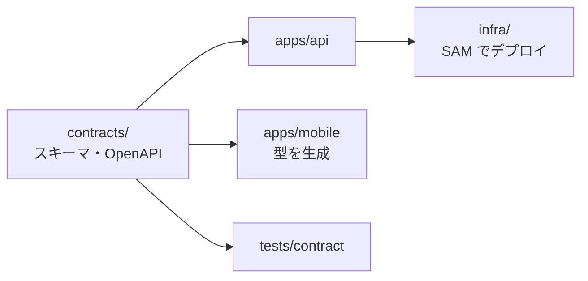

# フォルダ構成

> ステータス: **確定（Accepted）** — [ADR-0002](../adr/0002-monorepo-and-folder-structure.md)
> 最終更新: 2026-11-14

## 設計方針

1. **ドキュメントが一次情報**。コードより先に `docs/` と `contracts/` を書く（仕様駆動）。
2. **機械可読な契約（`contracts/`）を唯一の正（SSOT）とする**。Claude API の入出力、アプリ⇔バックエンドAPI、ドメインモデルは JSON Schema / OpenAPI で定義し、ドキュメント・テスト・実装はすべてそこを参照する。
3. **モノレポ**。仕様・契約・PoC・アプリ・インフラを1リポジトリに置き、契約変更が全体のテスト（CI）に即座に効くようにする。
4. **ディレクトリ名・ファイル名は英語（ASCII）**、ドキュメント本文は日本語。CLI・CI・シェルでのクォート問題を避けるため。
5. **セッション外部記憶は `docs/00_project/` に集約**（ロードマップ・進捗ログ・未決事項）。
6. **Python は uv のワークスペース**（ルートがワークスペースのルート、`apps/api` がメンバー、`uv.lock` は1つ）。**JavaScript は `apps/mobile` だけで npm**。

`（未作成）` は置き場所だけ決めてあり、必要になったときに作るもの。

## ツリー

```
onaka-log/
├── CLAUDE.md                     # Claude Code の入口。開発ルール・セッション開始/終了手順
├── README.md                     # 人間向けの概要
├── pyproject.toml                # uv ワークスペースのルート。契約テスト・PoC 用の依存（dev / poc グループ）
├── uv.lock                       # Python の依存のロック（ワークスペース全体で1つ）
├── .python-version / .gitignore / .gitattributes / .env.example
│
├── docs/                         # 仕様・設計（What / Why / How）
│   ├── README.md                 # ドキュメント索引・記法・ID体系
│   ├── 00_project/               # ★プロジェクト管理・外部記憶
│   │   ├── roadmap.md            #   全体ロードマップ兼チェックリスト（現在地もここ）
│   │   ├── progress-log.md       #   セッションごとの作業ログ・引継ぎ
│   │   ├── open-questions.md     #   ユーザー判断待ちの未決事項
│   │   ├── folder-structure.md   #   本ファイル
│   │   ├── dev-environment.md    #   開発環境（WSL・uv）
│   │   └── glossary.md           #   用語集（未作成）
│   ├── 01_requirements/          # 要件（What）
│   │   ├── scope.md              #   MVP / 次期 / 将来 のスコープ分け
│   │   ├── features/             #   機能一覧（README.md）と機能仕様（1機能1ファイル、ID: F-xxx）
│   │   ├── non-functional.md     #   非機能要件（ID: NFR-xxx）
│   │   └── vision.md             #   目的・対象ユーザー・非ゴール（未作成）
│   ├── 02_design/                # 設計（How）
│   │   ├── architecture.md       #   全体構成（構成図は diagrams/）
│   │   ├── diagrams/             #   AWS 構成図の元コード（Python diagrams）と PNG
│   │   ├── domain-model.md       #   ドメインモデル（Meal / FoodItem、ルール DM-xx）
│   │   ├── data-model.md         #   DynamoDB のテーブル・キー・操作
│   │   ├── data-access-patterns.md # アクセスパターン（AP-xx）
│   │   ├── api.md                #   API の設計方針・エラー体系（契約本体は contracts/api）
│   │   ├── auth.md / infra.md    #   認証・インフラの詳細（未作成）
│   │   ├── llm/                  #   Claude API 利用設計（未作成。契約は contracts/llm）
│   │   ├── screens/              #   画面一覧・遷移図・ワイヤーフレーム（UIX）
│   │   └── discussions/          #   判断材料・比較検討の資料（決定は ADR に書く）
│   ├── 03_testing/               # テスト戦略・トレーサビリティ・評価(eval)方針（TST）
│   ├── 04_operations/            # CI/CD・リリース・監視・運用手順（OPS）
│   ├── adr/                      # Architecture Decision Records（決定の記録）
│   └── templates/                # 機能仕様・ADR・PoCレポートのテンプレート
│
├── contracts/                    # ★機械可読な契約（SSOT）。スタック非依存
│   ├── domain/                   #   meal.schema.json と examples/{valid,invalid}
│   ├── api/                      #   openapi.yaml（OpenAPI 3.1）と examples/{valid,invalid}
│   └── llm/<usecase>/            #   nutrition-label-ocr, food-photo-estimate
│       ├── input.schema.json     #     推定モジュールへの入力
│       ├── output.schema.json    #     Claude に強制する出力（Structured Outputs）
│       ├── prompt.md             #     システムプロンプト（prompt_version 付き）
│       └── examples/             #     valid / invalid の例
│
├── apps/                         # プロダクトコード
│   ├── api/                      #   バックエンド: Python / FastAPI（Lambda Web Adapter で Lambda 上で動かす）
│   │   ├── pyproject.toml        #     uv ワークスペースのメンバー（パッケージ名 onaka-api）
│   │   ├── src/onaka_api/
│   │   │   ├── main.py           #       FastAPI アプリ（ローカルは uvicorn で起動）
│   │   │   ├── routers/          #       API の入口（estimates / products / meals）。contracts/api に合わせる
│   │   │   ├── domain/           #       ドメインのルール（倍率・合計・記録日、DM-01〜08）。外部に依存しない純粋なコード
│   │   │   ├── estimation/       #       推定・照合（Claude 呼び出し、Open Food Facts、出力の検証、候補への変換）
│   │   │   ├── repository/       #       DynamoDB の読み書き
│   │   │   └── settings.py       #       設定（環境ごとのモデルID・テーブル名など。LLM-08）
│   │   └── tests/                #     単体テスト・API テスト（Claude はモック、DB は DynamoDB Local）
│   └── mobile/                   #   スマホアプリ: React Native（Expo）+ TypeScript、npm
│       ├── package.json / app.json
│       ├── app/                  #     画面（ルーティング。ライブラリは TEC-03 で決める）
│       └── src/
│           ├── api/              #       API クライアント（contracts/api/openapi.yaml から生成。TEC-07）
│           ├── features/         #       機能ごとのコード（記録・一覧・確認画面など）
│           └── components/       #       共通の部品
│
├── infra/                        # IaC（AWS SAM、ADR-0014）
│   ├── template.yaml             #   Lambda・HTTP API・DynamoDB・Cognito・ロール・ロググループ・予算アラート
│   └── samconfig.toml            #   環境ごとの設定（dev / prod）
│
├── tests/                        # スタック横断テスト（各アプリの単体テストは各アプリ内）
│   ├── contract/                 #   契約テスト（llm / domain / api）とルールの参照実装（domain_rules.py, api_rules.py）
│   ├── e2e/                      #   E2E（未作成。TST-08）
│   └── eval/                     #   LLM の回帰評価（未作成。通常 CI とは分けて手動・定期実行、TST-07）
│
├── poc/                          # PoC（M2 完了）。結果は reports/ と docs に残してある
│   ├── README.md                 #   PoC 計画
│   ├── shared/                   #   共通処理（Claude 呼び出し・スキーマ・画像・料金）
│   ├── poc1-barcode/ / poc2-label-ocr/ / poc3-food-photo/
│   ├── samples/                  #   評価用サンプル（画像は Git 管理外、CSV は管理）
│   ├── results/                  #   実行結果（Git 管理外）
│   └── reports/                  #   PoC 結果レポート・まとめ
│
├── tools/                        # 開発補助スクリプト（コード生成など）
├── .github/workflows/            # CI/CD（未作成。CIC）
├── .claude/skills/handoff/       # セッション終了時の引継ぎ手順
└── work/                         # 個人の作業メモ・日記（Git 管理外）
```

> 旧資料を置いていた `old/` は 2026-11-12 に削除した。必要ならコミット `dbe0211` 以前の Git 履歴から参照できる。
> 比較資料はリポジトリ直下の `議論/` に置いていたが、2026-11-12 に `docs/02_design/discussions/` へ移した（英数字名の規約に合わせた）。
> `packages/`（共有ライブラリ）は作らない（ADR-0002）。

## 置き場所のルール

| 何を | どこに |
|---|---|
| 「何を作るか」 | `docs/01_requirements/` |
| 「どう作るか」 | `docs/02_design/` |
| 「なぜそう決めたか」 | `docs/adr/` |
| 機械が検証する約束事 | `contracts/` |
| まだ決まっていないこと | `docs/00_project/open-questions.md` |
| 決める前の比較・検討資料 | `docs/02_design/discussions/` |
| 個人の作業メモ（Git 管理外） | `work/` |
| 今どこまで進んだか | `docs/00_project/roadmap.md`（チェック）＋ `progress-log.md`（経緯） |
| バックエンドのコード・単体テスト | `apps/api/src/onaka_api/`・`apps/api/tests/` |
| アプリのコード・単体テスト | `apps/mobile/`（テストの置き方は TEC-08 で決める） |
| AWS のリソース定義 | `infra/` |
| 契約テスト・E2E・LLM 評価 | ルートの `tests/` |

## 依存関係の向き



- `apps/api` は `contracts/llm` のプロンプト・スキーマを実行時に読む。Lambda に載せるため、ビルド時に `contracts/` を同梱する（具体的な方法は SAM のビルド設定を書くときに決める）
- `apps/mobile` は `contracts/api/openapi.yaml` から型・クライアントを生成し、手で型を書かない
- `apps/api` の中では、`domain/` は他のフォルダに依存しない（ARC-05 のレイヤ分けの詳細は実装時）
