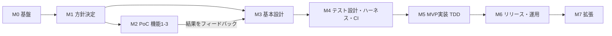

# ロードマップ兼チェックリスト

> **このファイルはプロジェクトの「現在地」を示す一次情報。** セッション開始時に必ず読み、終了時に更新する。
> 経緯・判断理由は [progress-log.md](progress-log.md) と [adr/](../adr/) に書き、ここにはチェック状態と成果物リンクだけを残す。

## 現在地

| 項目 | 内容 |
|---|---|
| 現在のマイルストーン | **M2 PoC**（M1 の残り: REQ-05・DAT-00/01 は並行で進める） |
| 次にやること | ① `not_nutrition_label` の確認（キーボード写真、1円未満） ② 料理写真のサンプル収集（ユーザー、PoC-3 用）→ PoC-3 スクリプト ③ REQ-05 機能一覧・DAT-00 アクセスパターン（並行） ④ INF-10 の残り |
| ブロッカー | なし（技術スタックの主要な決定はそろった） |
| 最終更新 | 2026-11-13 |

## 凡例

- `[ ]` 未着手 / `[x]` 完了 / 末尾に `(WIP)` = 着手中 / `(SKIP: 理由)` = 不要と判断
- **ID** はドキュメント・テスト・コミットから参照する。採番済みIDは変更・再利用しない（削除時は SKIP にする）
- **★** = 他の多くの項目の前提になる重要決定（早めに決める）
- **成果物** = 完了の定義。そのファイルが書かれて合意されたら `[x]`

## マイルストーン概要

| MS | 名前 | 完了条件 | 主なカテゴリ |
|---|---|---|---|
| M0 | プロジェクト基盤 | リポジトリ・ドキュメント規約・外部記憶の仕組みが整う | PRJ, HNS(一部) |
| M1 | 方針決定 | ★項目（利用者範囲・MVPスコープ・ドメインの骨格）が決まる | REQ(★), DAT-01〜03 |
| M2 | PoC（機能1〜3） | 各方式の実用性が判定され、LLM契約の初版が固まる | POC, LLM(一部), TST-03 |
| M3 | 基本設計 | 技術スタック・アーキ・認証・データ・インフラ・画面・API契約が ADR 化 | ARC, TEC, AUT, DAT, INF, UIX, LLM |
| M4 | テスト設計・ハーネス・CI | 「このテストをパスするまで実装して」で実装を回せる状態 | TST, HNS, CIC |
| M5 | MVP実装 | MVPスコープの全機能がテスト緑で動く | IMP |
| M6 | リリース・運用 | 自分（＋想定ユーザー）が日常利用できる | SEC, OPS, CIC(配布) |
| M7 | 拡張 | バックログから順次 | EXT |

> M2（PoC）と M3（基本設計）の一部は並行可。ただし **PoC 結果でスコープや入力方式が変わり得る** ため、技術スタック（TEC）の最終決定は PoC 後が望ましい。

---

## PRJ: プロジェクト基盤・運営（M0）

- [x] **PRJ-01 ★** リポジトリの独立化（`onaka-log` 単独リポジトリ、改行コードは `.gitattributes` で LF に統一）
- [x] **PRJ-02** GitHub リモート作成 — `t-teieki/onaka-log`
- [ ] **PRJ-03** ブランチ戦略（例: GitHub Flow / trunk-based）、main 保護ルール
- [ ] **PRJ-04** コミット規約（例: Conventional Commits）・PR テンプレート（仕様ID記載欄）
- [x] **PRJ-05** フォルダ構成の初版 — 成果物: [folder-structure.md](folder-structure.md)
- [ ] **PRJ-06** フォルダ構成の確定（TEC 決定後に `apps/` 具体化） — 成果物: ADR-0002 を Accepted に
- [ ] **PRJ-07** ドキュメント規約（記法・ID体系・テンプレート）の確定 — 成果物: [docs/README.md](../README.md), `docs/templates/`
- [ ] **PRJ-08** 機能仕様テンプレート・PoCレポートテンプレート作成
- [ ] **PRJ-09** 用語集の作成（食事 / 食品 / 推定 / 記録元 / 基準量 など） — 成果物: `glossary.md`
- [ ] **PRJ-10** 開発環境の前提：リポジトリは C ドライブ（問題が出たら WSL 側へ移す）、開発は WSL から（Q-18, Q-20）。ランタイムのバージョン管理・エディタ設定は未決 — 成果物: [dev-environment.md](dev-environment.md) (WIP)
- [ ] **PRJ-11** シークレット管理方針（`.env` / ローカル / CI / 本番の分離、`.env.example`）
- [ ] **PRJ-12** ライセンス・公開範囲（OSS にするか）
- [ ] **PRJ-13** タスクランナー（Makefile / just / Taskfile / npm scripts）— 「テスト実行」等を1コマンドに統一

## HNS: Claude Code ハーネス（M0〜M4）

- [x] **HNS-01** CLAUDE.md 初版（セッション開始/終了手順・開発ルール） — 成果物: [/CLAUDE.md](../../CLAUDE.md)
- [x] **HNS-02** 引継ぎ用 skill（`/handoff`） — 成果物: `.claude/skills/handoff/SKILL.md`
- [ ] **HNS-03** TDD 運用ルールの明文化：「テストが仕様」。実装フェーズではテスト・契約を変更しない。変更が必要なら仕様→契約→テストの順に戻る
- [ ] **HNS-04** テスト改変の機械的ガード（例: 実装タスク中に `tests/`・`contracts/` の編集を hook で警告/ブロック）
- [ ] **HNS-05** `.claude/settings.json`：permissions allowlist（テスト・lint 実行など）、PostToolUse hook（format / lint）
- [ ] **HNS-06** サブディレクトリ CLAUDE.md（`apps/mobile/`, `apps/api/`, `contracts/`, `poc/` ごとの規約）
- [ ] **HNS-07** カスタム skill 群の検討：`/spec`（機能仕様の起票）、`/spec-to-test`（仕様→テスト生成）、`/implement`（指定テストが緑になるまで実装）、`/adr`（ADR起票）
- [ ] **HNS-08** サブエージェント検討：仕様レビュー役、テスト作成役、契約整合性チェック役
- [ ] **HNS-09** MCP 連携の要否（GitHub、DB、デザインツールなど）
- [ ] **HNS-10** Claude Code GitHub Actions（PRレビュー自動化）の要否 → CIC と連携
- [ ] **HNS-11** 仕様⇔テストのトレーサビリティ確認スクリプト（全 F-xxx に対応テストがあるか）

## REQ: 要件定義（M1）

- [x] **REQ-01 ★** 利用者範囲：直近は自分専用、将来はストアで一般公開 — 成果物: [ADR-0003](../adr/0003-phased-release-design.md)
- [ ] **REQ-02 ★** プロダクトビジョン・提供価値・非ゴール — 成果物: `01_requirements/vision.md`
- [ ] **REQ-03** ペルソナ・主要ユースケース（いつ・どこで・何を記録するか）
- [x] **REQ-04 ★** MVP スコープ：入力方式はバーコード・OCR・写真推定・テキスト入力。閲覧は日次合計＋食事一覧、確認・修正、削除 — 成果物: [scope.md](../01_requirements/scope.md)
- [ ] **REQ-05** 機能一覧と機能ID採番（F-xxx） — 成果物: `01_requirements/features/`
- [ ] **REQ-06** 記録フロー仕様：入力方式選択 → 取得/推定 → 確認・修正 → 食事に追加 → 保存
- [ ] **REQ-07** 1食に複数食品を紐づける仕様（追加・削除・並べ替え・後から追記）
- [ ] **REQ-08** 分量の扱い：人は入力せず読み取り・推定で決める方針（Q-08）。換算ルールは REQ-23 (WIP)
- [ ] **REQ-09** 食事区分（朝/昼/夕/間食/自由入力?）と初期値ルール
- [ ] **REQ-10** 日付の境界は **4:00** に決定。タイムゾーン・過去日時の記録は未決 (WIP)
- [ ] **REQ-11** 閲覧仕様：日次合計・PFCバランス・食事ごと小計・週/月推移（グラフ種類）
- [ ] **REQ-12** 編集・削除仕様（食事単位/食品単位、確認ダイアログ、取り消し）
- [ ] **REQ-13** 推定値の扱い：記録元・信頼度の表示、AI推定値と確定値の区別、修正履歴を残すか
- [ ] **REQ-14** 再利用機能：履歴から再記録・お気に入り・よく食べるもの（MVP か拡張か）
- [ ] **REQ-15** 目標値（カロリー・PFC）と達成度（MVP か拡張か）
- [ ] **REQ-16** 対象栄養素：カロリー・PFC のみか、食塩相当量・食物繊維・糖質等を将来拡張できる設計にするか
- [ ] **REQ-17** オフライン要件（閲覧・手入力はオフライン可か、推定はオンライン必須か）
- [ ] **REQ-18** 非機能要件：コスト上限（月1000円）・画像非保存・対応OS は決定。応答時間などは PoC 後 — 成果物: [non-functional.md](../01_requirements/non-functional.md) (WIP)
- [x] **REQ-19** 画像の保持方針：推定後すぐ破棄し、どこにも保存しない — 成果物: [ADR-0004](../adr/0004-no-image-retention.md)
- [ ] **REQ-20** データのエクスポート・アカウント削除・データ削除要件
- [ ] **REQ-21** 多言語・単位系（日本語のみ? kcal 固定?）
- [ ] **REQ-22** アクセシビリティ・ダークモード
- [ ] **REQ-23** 分量の自動決定ルール：既定は「全部食べた」、ワンタップ選択（1/4・1/2 など）で修正可に決定。内容量が読めない場合の扱いは PoC 後 — 成果物: [scope.md](../01_requirements/scope.md) (WIP)
- [x] **REQ-24** 読み取れない場合：エラーダイアログを表示し、ホームの読み取り方式選択画面に戻る — 成果物: [scope.md](../01_requirements/scope.md)

## POC: PoC 機能1〜3（M2）

共通
- [x] **POC-01** PoC 計画（目的・合格基準・サンプルと正解データの形式・費用の上限） — 成果物: [poc/README.md](../../poc/README.md)
- [x] **POC-02** PoC 実行環境：WSL ＋ uv（Python 3.12）、anthropic SDK 2.8.0、jsonschema、pillow、httpx。共通処理は `poc/shared/`
- [ ] **POC-03** 評価サンプル収集と正解データ作成（バーコード番号 30前後、栄養成分表示写真 20前後、料理写真＋正解値 20〜30） — 成果物: `poc/samples/`（画像は Git 管理外、正解値 CSV は管理）。ユーザーが用意中 (WIP)
- [ ] **POC-04** 評価指標と評価スクリプト（正答率・誤差率・レイテンシ・コスト・出力のブレ）
- [ ] **POC-05** PoC 結果レポートと判断（採用/条件付き採用/不採用） — 成果物: `poc/reports/`, ADR

機能1: バーコード照合
- [ ] **POC-11** 商品DB候補の洗い出し（Open Food Facts、国内の商品DB/API（有償含む）、自前DB蓄積）とライセンス確認
- [x] **POC-12** ヒット率・栄養値の充足率・パッケージ表示との一致度・基準量・内容量が取れる割合の計測（5件: 使える割合 100%、一致 4/5、内容量 1/5・1食分の量を含めると 4/5） — 成果物: [poc1-barcode.md](../../poc/reports/poc1-barcode.md)
- [x] **POC-13** 登録ミス時・内容量がない時の扱い：OCR へのワンタップ切り替え、内容量不明でも基準を付けて登録 — 成果物: [ADR-0009](../adr/0009-barcode-adoption-and-net-content.md)（未ヒット時は scope.md のとおりエラーダイアログ→方式選択）
- [ ] **POC-14** 端末でのバーコード読み取り（ML Kit 等）は TEC 決定後に実機で小さく確認

機能2: 栄養成分表示 OCR
- [ ] **POC-21** 方式比較：Claude Vision に画像を直接渡す方式で、読める写真（4枚中3枚）はすべて正確。読めない写真は上位モデルでも読めなかったため、端末 OCR との比較は保留
- [x] **POC-22** 出力スキーマと Structured Outputs での強制（v0.3。表示の列ごとに `columns` で返す。null を許す enum は anyOf で書く） — 成果物: [contracts/llm/nutrition-label-ocr/](../../contracts/llm/nutrition-label-ocr/)
- [ ] **POC-23** 精度計測：写真4枚。読める3枚は全モデル kcal・P・F・C 正確（逆光も可）。袋の曲面・斜め・小さい文字の1枚は全モデル unreadable（推測なし）、正面から撮り直すと Haiku でも正確。複数列は全列を返して利用者が選ぶ（Q-26、スキーマ v0.3 で対応し、API で2列が返ることを確認） — 成果物: [poc2-label-ocr.md](../../poc/reports/poc2-label-ocr.md) (WIP)
- [ ] **POC-24** 読み取り不可時の返し方：`unreadable` は全モデルで確認（数値は null、撮り直しの助言つき）。`not_nutrition_label` は未検証。アプリでは撮り直しを案内する（Q-25 → scope.md） (WIP)

機能3: 撮影画像から推定
- [ ] **POC-31** 出力スキーマ初版（料理名・複数品目への分解・推定量・カロリー・PFC・信頼度）
- [ ] **POC-32** 精度計測（カロリー誤差の中央値・PFC誤差・料理名の妥当性・同一画像での再現性）
- [ ] **POC-33** 1枚の写真に複数料理がある場合の扱い（食事1件＋食品N件に自然にマップできるか）
- [ ] **POC-34** 推定不能時（食べ物でない・ぼやけ）の返し方

横断
- [ ] **POC-41** モデル比較：OCR は写真4枚（厳しい条件2枚を含む）で全モデル同じ結果、Haiku 5.5・effort low に決定（[ADR-0010](../adr/0010-label-ocr-model-and-image-size.md)）。写真推定は未実施 (WIP)
- [ ] **POC-42** 画像の縮小：OCR は長辺 1024px で元サイズと同じ精度、768px で1か所誤読。写真推定は未実施 (WIP)
- [ ] **POC-43** 1回あたりの費用（OCR）: Haiku 約0.1円 / Sonnet 約2円 / Opus 約4円。費用の大半は入力（画像＋スキーマ＋プロンプト） (WIP)
- [ ] **POC-44** プロンプトキャッシュの効果：OCR では未使用。入力の約6割がスキーマとプロンプトなので効果が見込める。未検証

## LLM: Claude API 利用設計（M2〜M3）

- [ ] **LLM-01 ★** Claude を使う箇所の確定：OCR構造化 / 写真推定 / テキスト入力推定 / （任意）バーコード未ヒット補完 / （将来）アドバイス — 成果物: `02_design/llm/README.md`
- [x] **LLM-02 ★** 呼び出し経路：**バックエンド経由**に決定（APIキー保護・コスト制御） — 成果物: [ADR-0003](../adr/0003-phased-release-design.md)
- [x] **LLM-03 ★** 用途ごとの入出力契約（JSON Schema）初版 v0.1：OCR・写真推定・テキスト推定のスキーマ・プロンプト・例。OCR は PoC-2 の結果で出力 v0.3・prompt 0.2.0 に改訂 — 成果物: [contracts/llm/](../../contracts/llm/README.md)（PoC の結果で改訂する）
- [x] **LLM-04** 出力の強制方式：Structured Outputs（`output_config.format`）。スキーマは制約込みの完全版で書き、API 未対応の制約は SDK が除去してクライアント側で検証 — 成果物: [contracts/llm/README.md](../../contracts/llm/README.md)
- [ ] **LLM-05** 不確実性の表現：`status`（エラー種別）・`confidence`・`issues`・`assumptions` を v0.1 に入れた。PoC で妥当性を確認 (WIP)
- [ ] **LLM-06** 数値の単位・基準量・丸め規則の統一（kcal, g、小数何桁）
- [x] **LLM-07** プロンプトのバージョン管理：`prompt.md` の `prompt_version` とスキーマ `$id` のバージョン。推定結果にモデルIDと一緒に記録する — 成果物: [contracts/llm/README.md](../../contracts/llm/README.md)
- [ ] **LLM-08** モデル・effort の設定外部化（用途ごとに切替可能に）
- [ ] **LLM-09** タイムアウト・リトライ・レート制限・`refusal` 等の stop_reason ハンドリング方針
- [ ] **LLM-10** コスト制御：ユーザーごと回数制限、画像サイズ上限、キャッシュ
- [ ] **LLM-11** プロンプトインジェクション対策：画像内・説明文内の指示に従わないルールを v0.1 プロンプトに入れた。出力はスキーマ検証済みのみ採用。PoC で確認 (WIP)
- [ ] **LLM-12** ログ方針（入出力・トークン数・レイテンシを記録、画像そのものは残すか）
- [ ] **LLM-13** LLM プロバイダ抽象化（推定エンジンを interface 化し差し替え可能に）
- [ ] **LLM-14** 回帰評価（eval）：プロンプト/モデル変更時に PoC データセットで精度比較 → TST-07

## ARC: アーキテクチャ（M3）

- [ ] **ARC-01 ★** 全体構成：モバイル / バックエンド / DB / ストレージ / 外部API（Claude・商品DB）の配置 — 成果物: `02_design/architecture.md`
- [ ] **ARC-02 ★** データの主たる置き場所：ローカルファースト（端末DB＋同期） / サーバーファースト / 端末のみ
- [x] **ARC-03 ★** バックエンド形態：AWS サーバーレス（API Gateway + Lambda + Cognito） — 成果物: [ADR-0007](../adr/0007-backend-aws-serverless.md)
- [ ] **ARC-04** API スタイル：REST + OpenAPI / GraphQL / RPC
- [ ] **ARC-05** レイヤ構成：ドメイン・ユースケース・アダプタの分離（ヘキサゴナル / クリーンアーキ）
- [ ] **ARC-06** 推定方式のプラグイン化：`Estimator`（barcode / label-ocr / photo / text / manual）共通インターフェース → 新方式追加に強く
- [ ] **ARC-07** 推定処理の同期/非同期（待ち時間が長い場合のジョブ化・ポーリング/プッシュ）
- [ ] **ARC-08** エラー体系・エラーコード（クライアント表示文言との対応） — 成果物: `02_design/error-handling.md`
- [ ] **ARC-09** API バージョニング方針（モバイルは旧バージョンが残るため必須）
- [ ] **ARC-10** 設定管理・Feature flag（新入力方式の段階公開など）
- [ ] **ARC-11** ロギング・監視・トレース・クラッシュレポート
- [ ] **ARC-12** 拡張シナリオ検証：栄養素追加 / 新入力方式 / LLM差し替え / 複数ユーザー共有 / ヘルスケア連携 に設計が耐えるか

## TEC: 技術スタック（M3、PoC 後に確定）

- [x] **TEC-01 ★** モバイル：React Native（Expo）+ TypeScript — 成果物: [ADR-0005](../adr/0005-mobile-react-native-expo.md)
- [ ] **TEC-02** 対応OS：iOS・Android 両方に決定。最小OSバージョンは未決 (WIP)
- [ ] **TEC-03** 状態管理・ルーティング・DI
- [ ] **TEC-04** 端末DB（必要なら）：SQLite 系（drift / expo-sqlite 等）
- [x] **TEC-05 ★** バックエンド言語・FW：Python（FastAPI）を Lambda で動かす — 成果物: [ADR-0007](../adr/0007-backend-aws-serverless.md)
- [x] **TEC-06 ★** サーバDB：DynamoDB（ORM・マイグレーションツールは不要、アイテムの形は JSON Schema で定義） — 成果物: [ADR-0008](../adr/0008-database-dynamodb.md)
- [ ] **TEC-07** スキーマ検証・コード生成：JSON Schema → 型生成（各言語）、OpenAPI → クライアント生成
- [ ] **TEC-08** テストFW（単体 / ウィジェット・コンポーネント / API / E2E）
- [ ] **TEC-09** Lint / Formatter / 型チェック
- [ ] **TEC-10** バーコード読み取り・カメラ・画像圧縮ライブラリ
- [ ] **TEC-11** グラフ描画ライブラリ
- [ ] **TEC-12 ★** Mac なしでの iOS ビルドと実機確認の方法（Expo Go / EAS Build / Codemagic など）
- [ ] **TEC-13** Apple Developer Program・Google Play の登録時期：費用は月1000円とは別枠と決定。登録時期は後で検討（Q-13）
- [ ] **TEC-14** Android の検証手段（Windows 上のエミュレータ、将来の実機）

## AUT: 認証・認可（M3）

- [x] **AUT-01 ★** 認証の導入時期：最初から入れる — 成果物: [ADR-0006](../adr/0006-auth-from-day-one.md)
- [x] **AUT-02** 認証方式：Sign in with Apple + Google（メール＋パスワードは作らない） — 成果物: [ADR-0006](../adr/0006-auth-from-day-one.md)
- [x] **AUT-03** IdP：Amazon Cognito — 成果物: [ADR-0007](../adr/0007-backend-aws-serverless.md)（Expo からの Apple / Google ログイン連携は実装時に検証）
- [ ] **AUT-04** トークン管理：アクセス/リフレッシュトークン、端末内の安全な保存（Keychain / Keystore）
- [ ] **AUT-05** 認可：全データを user_id でスコープ（行レベルセキュリティ等）
- [ ] **AUT-06** 将来の権限拡張：家族/トレーナーとの共有、管理者ロール
- [ ] **AUT-07** API 不正利用対策：レート制限、App Attest / Play Integrity
- [ ] **AUT-08** アカウント削除フロー（ストア要件）
- 成果物: `02_design/auth.md`

## DAT: データ管理（M1〜M3）

- [ ] **DAT-00 ★** アクセスパターンの洗い出し（日次一覧・食事詳細・削除・将来の推移など）→ DynamoDB のキー設計の前提（ADR-0008）
- [ ] **DAT-01 ★** ドメインモデル：User / Meal（食事）/ FoodItem（食品、Meal と 1:N）/ Nutrition（栄養値の値オブジェクト）/ EstimationSource（記録元）/ EstimationRun（推定の生結果）/ Product（バーコード商品）/ Goal — 成果物: `02_design/domain-model.md`, `contracts/domain/`
- [ ] **DAT-02 ★** Meal の合計値：都度計算 / 保存（非正規化）。整合性と集計性能のトレードオフ
- [ ] **DAT-03** 栄養値の型と精度（小数・丸め・null=不明 の扱い）、拡張栄養素の持ち方（列追加 / 可変キー）
- [ ] **DAT-04** 分量モデル：基準量（per 100g / per serving）×摂取量 → 実摂取値。元値と換算後の両方を保持するか
- [ ] **DAT-05** AI推定の生データ保存（モデルID・プロンプト版・生出力・ユーザー修正差分）→ 精度改善・監査用
- [ ] **DAT-06** ID 方式（UUIDv7 等をクライアント生成 → オフライン/同期に有利）
- [ ] **DAT-07** 日時の保存（UTC＋タイムゾーン、"食べた日" のローカル日付）
- [ ] **DAT-08** 論理削除 / 物理削除、更新履歴
- [ ] **DAT-09** 同期と競合解決（ARC-02 でローカルファーストを選んだ場合）
- [ ] **DAT-10** 商品マスタ：外部DB結果のキャッシュ、ユーザー登録商品、共有するか個人別か
- [ ] **DAT-11** 画像ストレージ (SKIP: 画像を保存しないため。ADR-0004)
- [ ] **DAT-12** マイグレーション戦略（サーバ・端末とも）、シードデータ
- [ ] **DAT-13** バックアップ・リストア・エクスポート形式（CSV / JSON）
- [ ] **DAT-14** 個人情報・健康関連情報の分類と取扱い
- 成果物: `02_design/data-model.md`

## INF: インフラ（M3）

- [x] **INF-01 ★** ホスティング先：AWS、東京リージョン（ap-northeast-1）を基本 — 成果物: [ADR-0007](../adr/0007-backend-aws-serverless.md)
- [ ] **INF-10 ★** AWS アカウントの準備：アカウント作成は済み。残りは、プランの確認（Free プランなら6か月で閉じられるため Paid への切り替え時期を決める）、AWS Budgets の予算アラート、root ユーザーの MFA、作業用 IAM ユーザー/ロール (WIP)
- [ ] **INF-02** 環境構成：local / dev（staging）/ prod の分離
- [ ] **INF-03** IaC の方式：AWS SAM / CDK / Terraform（ADR-0007 で IaC は必須とした）
- [ ] **INF-04** シークレット管理（Claude APIキー等はサーバ側のみ、CI は GitHub Secrets / OIDC）
- [ ] **INF-05** ローカル開発環境（エミュレータ、ローカルDB、モックサーバ）
- [ ] **INF-06** コスト見積り（無料枠・Claude API）と予算アラート。上限は月1000円（NFR-001、目安は non-functional.md）
- [ ] **INF-07** 監視・アラート・ログ保管
- [ ] **INF-08** バックアップと復旧手順
- [ ] **INF-09** ドメイン・TLS（必要なら）
- 成果物: `02_design/infra.md`

## UIX: 画面設計・UX（M3）

- [ ] **UIX-01** 画面一覧と画面遷移図 — 成果物: `02_design/screens/README.md`
- [ ] **UIX-02** ホーム（今日の合計・PFCバランス・食事一覧）
- [ ] **UIX-03** 記録フロー：入力方式選択 → スキャン/撮影/入力 → 推定中 → 結果確認・修正 → 食事への追加（複数食品）→ 保存
- [ ] **UIX-04** 推定結果確認画面：信頼度表示、修正しやすさ、複数候補の選択
- [ ] **UIX-05** 食事詳細・食品編集画面
- [ ] **UIX-06** 履歴（カレンダー / 日付移動）・推移グラフ
- [ ] **UIX-07** 設定（目標値・アカウント・データ管理）
- [ ] **UIX-08** オンボーディング・カメラ権限要求・権限拒否時の導線
- [ ] **UIX-09** ローディング・エラー・空状態のパターン
- [ ] **UIX-10** ワイヤーフレームの作成方法（Figma / HTMLモック / 手書き）
- [ ] **UIX-11** デザインシステム（色・タイポ・コンポーネント）、ダークモード
- [ ] **UIX-12** 入力の手間の最小化（タップ数目標、片手操作）

## TST: テスト戦略（M2〜M4）

- [ ] **TST-01 ★** テスト戦略：レイヤごとの責務とテストピラミッド — 成果物: `03_testing/strategy.md`
- [ ] **TST-02 ★** 仕様⇔テストのトレーサビリティ規約（テスト名・タグに F-xxx / NFR-xxx を含める）
- [x] **TST-03 ★** 契約テスト：例の適合・不適合、Structured Outputs 互換、意味上のルールを検査（pytest、88件） — 成果物: [tests/contract/](../../tests/contract/README.md)
- [ ] **TST-04** Claude API のモック方針：記録済みレスポンス（フィクスチャ）で単体テスト、実API は別枠
- [ ] **TST-05** 実API スモークテスト（手動/定期実行、コスト上限付き）
- [ ] **TST-06** API 契約テスト（実装が OpenAPI に準拠しているか）
- [ ] **TST-07** LLM 精度評価（eval）：PoC データセットを回帰用に流用、合格しきい値、レポート形式 — `tests/eval/`
- [ ] **TST-08** E2E テストツール選定（モバイル）
- [ ] **TST-09** テストデータ・フィクスチャ管理（画像サンプルの扱い含む）
- [ ] **TST-10** カバレッジ目標と計測
- [ ] **TST-11** 「テスト先行 → 実装」の手順書（誰が・いつ・どのテストを書くか、赤の確認方法） — HNS-03 と連動

## CIC: CI/CD（M4〜M6）

- [ ] **CIC-01** CI 基盤（GitHub Actions 想定）
- [ ] **CIC-02** PR 時のジョブ：lint / 型 / 単体 / 契約テスト / ビルド。パスフィルタで影響範囲だけ実行
- [ ] **CIC-03** 契約変更時に全関係者（mobile / api / tests）のテストを走らせる仕組み
- [ ] **CIC-04** LLM 実API テスト・eval の実行タイミング（手動トリガー / 夜間）とコスト上限
- [ ] **CIC-05** バックエンドの自動デプロイ（main → staging、タグ → prod）とDBマイグレーション
- [ ] **CIC-06** モバイルのビルドと配布（EAS / Codemagic / fastlane、TestFlight / Play 内部テスト）
- [ ] **CIC-07** バージョニング・リリースノート自動化
- [ ] **CIC-08** 依存更新（Dependabot / Renovate）・セキュリティスキャン
- [ ] **CIC-09** シークレットの CI 受け渡し（OIDC 推奨）
- [ ] **CIC-10** Claude による PR レビュー自動化（HNS-10）
- 成果物: `04_operations/ci-cd.md`

## SEC: セキュリティ・プライバシー・法務（M3〜M6）

- [ ] **SEC-01** APIキー保護（クライアントに持たせない）
- [ ] **SEC-02** 通信・保存データの暗号化
- [ ] **SEC-03** 画像・食事データを外部（Anthropic・商品DB）に送ることの説明と同意
- [ ] **SEC-04** プライバシーポリシー・利用規約（REQ-01 で配布する場合）
- [ ] **SEC-05** 医療・健康アドバイスではない旨の免責
- [ ] **SEC-06** 外部データのライセンス表記（例: Open Food Facts は ODbL）
- [ ] **SEC-07** ストア審査要件（アカウント削除、権限説明文、ヘルスケア関連）
- [ ] **SEC-08** 脅威モデリング（簡易）

## OPS: 運用（M6）

- [ ] **OPS-01** リリース手順・ロールバック手順
- [ ] **OPS-02** 障害時対応（Claude API 障害時のフォールバック：手入力へ誘導）
- [ ] **OPS-03** コスト監視と上限到達時の挙動
- [ ] **OPS-04** 推定精度の継続モニタリング（ユーザー修正率など）

## IMP: MVP 実装（M5）

> M3・M4 完了後に、機能仕様（F-xxx）単位でタスク化する。各タスクは「対応テストを先に用意 → 赤を確認 → 実装 → 緑」。

- [ ] **IMP-01** ウォーキングスケルトン（アプリ起動 → API 疎通 → DB 保存 → CI 緑）
- [ ] **IMP-02** ドメイン層（Meal / FoodItem / 合計計算）
- [ ] **IMP-03** 手入力・テキスト入力による記録
- [ ] **IMP-04** 閲覧（日次合計・一覧）
- [ ] **IMP-05** 編集・削除
- [ ] **IMP-06** バーコード照合
- [ ] **IMP-07** 栄養成分表示 OCR
- [ ] **IMP-08** 写真推定
- [ ] **IMP-09** 認証
- [ ] **IMP-10** 推移表示

## EXT: 拡張バックログ（M7〜、優先度未定）

- [ ] **EXT-01** 目標値と達成度
- [ ] **EXT-02** 履歴から再記録・お気に入り・テンプレート食事
- [ ] **EXT-03** 栄養素拡張（食塩・食物繊維・糖質 等）
- [ ] **EXT-04** 体重記録・ヘルスケア（HealthKit / Health Connect）連携
- [ ] **EXT-05** 公的食品成分データ（例: 日本食品標準成分表）を使ったテキスト入力の精度向上・食品検索
- [ ] **EXT-06** AI による食事アドバイス・振り返り
- [ ] **EXT-07** 家族・トレーナーとの共有
- [ ] **EXT-08** ウィジェット・通知（記録忘れリマインド）
- [ ] **EXT-09** Web 版・管理画面
