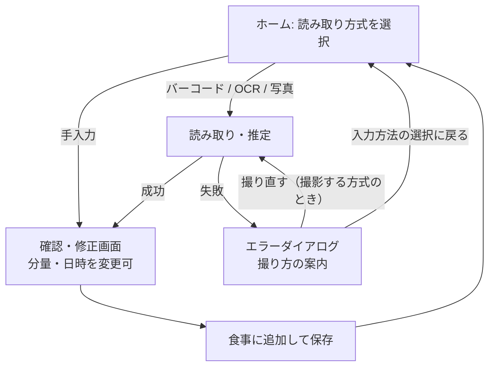

# スコープ（MVP / 次期 / 将来）

> ステータス: Draft（MVP の内容は合意済み。機能仕様 F-xxx への分解は REQ-05 で行う）
> 最終更新: 2026-11-13
> 関連: REQ-04, Q-03, Q-08, Q-09, Q-14〜Q-16, Q-19, Q-25〜Q-33

## 基本方針

- **人が入力する手間を極力なくす（UX 最優先）**。キーボード入力は最終手段とし、確認・修正はワンタップの選択で済むようにする。
- 記録単位は「食事（Meal）1件に食品（FoodItem）N件」。食品ごとの値と食事合計の両方を持つ。

## MVP

| 区分 | 内容 | 根拠 |
|---|---|---|
| 入力方式 | ①バーコード照合 ②栄養成分表示 OCR ③写真からの AI 推定 ④**手入力**（食品名と kcal・P・F・C を利用者が入力。①〜③で推定できない、または不正確なときの最後の手段。Claude は使わない） | Q-03, Q-19, Q-30, [ADR-0012](../adr/0012-manual-text-input.md) |
| 分量 | 人は入力しない。既定は「**全部食べた**」とみなす。オプションでワンタップ選択（1/4・1/2・1 など）で直せる。ただし「1個当たり」表示で複数個入りの商品は、既定を「**1個**」とし、ワンタップで個数を選ぶ | Q-08, Q-14, Q-27 |
| 読み取れない場合 | **エラーダイアログを表示する**。ダイアログには「**撮り直す**」ボタンと撮り方の案内（正面から・近づけて）を置き、「**入力方法の選択に戻る**」も残す（撮影する方式のとき） | Q-15, Q-25 |
| 1日の境界 | **4:00**（0:00〜3:59 の食事は前日分として集計） | Q-09 |
| 閲覧 | 日次合計＋食事一覧（4時区切り） | Q-16 |
| 確認・修正 | 推定結果の確認・修正画面。**保存後の値の修正はしない**（間違えたら削除して記録し直す） | Q-16, Q-31 |
| 削除 | 食品単位・食事単位の削除。食品が0件になった食事は自動で削除する | Q-16, Q-31 |
| 食事のまとまり | 1回の記録で1食事を作る。**後から同じ食事に食品を足せる**（例: 定食を写真で記録した後に飲み物をバーコードで足す）。食事区分（朝・昼・夕・間食）は持たず、時刻で並べる | Q-32 |
| 食べた日時 | 既定は記録した時刻。確認画面で変えられる（過去の日時も可）。保存後は変えない。タイムゾーンは日本時間に固定 | Q-33 |
| 認証 | Sign in with Apple + Google（最初から入れる） | Q-17, [ADR-0006](../adr/0006-auth-from-day-one.md) |

### 分量の決め方

| 方式 | 取れる値 | 既定の分量 |
|---|---|---|
| バーコード | 商品DBの 100g 当たり／1食当たりの値、内容量 | 1包装を全部。100g 当たりの値は内容量で換算する。内容量がなければ「1食当たり（推定）」、それもなければ「100g 当たり・内容量：不明」のまま登録し、日次合計に含める（[ADR-0009](../adr/0009-barcode-adoption-and-net-content.md)） |
| OCR | 表示の基準量（「1袋（45g）当たり」「100g 当たり」など）と値、内容量 | 1包装を全部。100g 当たりなら内容量（表示から読み取る）で換算する |
| 写真推定 | AI が推定した料理名・量・カロリー・PFC | 写っている量を全部 |
| 手入力 | 利用者が入力した食品名・kcal・PFC | 入力した値を食べた量の値としてそのまま登録（換算・ワンタップの分量選択はしない） |
| 共通 | — | 確認画面でワンタップ選択（1/4・1/2・1 など）で直せる |

- バーコードで内容量が取れない場合は「読み取れない場合」として扱わず登録する。値の基準と「内容量：不明」を必ず一緒に保存し、確認画面に出す（ADR-0009）。
- OCR で内容量が読めない場合は、バーコードと同じく登録し、「内容量：不明」を出す。100g 当たりの表示なら 100g 食べたとみなす（[domain-model.md](../02_design/domain-model.md) §2-3）。
- OCR で栄養成分表示に複数の列（味違い・基準違いなど）があるときは、Claude に全列を返させ、確認画面で利用者が列を選ぶ（Q-26。出力スキーマ v0.3 で対応）。
- 「1個当たり」表示で内容量が複数個（例: 4個入り）のときは、既定の分量を「1個」とし、ワンタップで個数（1・2・…・全部）を選ぶ（Q-27）。
- 写真推定の値は正解と照らし合わせず、推定値をそのまま登録する（目安値。確認画面で料理名・分量を直せる）（Q-28）。モデルは Sonnet 5.5（effort medium）（[ADR-0011](../adr/0011-food-photo-model.md)）。
- OCR のモデルは Haiku 5.5（effort low）、画像は長辺 1024〜1568px に縮小して送る（[ADR-0010](../adr/0010-label-ocr-model-and-image-size.md)）。
- バーコードの確認画面では値の出どころ（Open Food Facts）を表示し、ワンタップで OCR に切り替えられるようにする（登録ミス対策、ADR-0009）。

### 記録フロー（MVP の概略。詳しくは画面設計 UIX-03）

## MVP 外（次期以降）

- 推移グラフ（週・月）
- 目標値と達成度
- 履歴からの再記録・お気に入り
- 栄養素の拡張（食塩・食物繊維 など）
- その他は roadmap の EXT を参照

## スコープ外（作らない）

- 撮影画像の保存・表示（[ADR-0004](../adr/0004-no-image-retention.md)）
- メールアドレス＋パスワードのログイン（[ADR-0006](../adr/0006-auth-from-day-one.md)）
