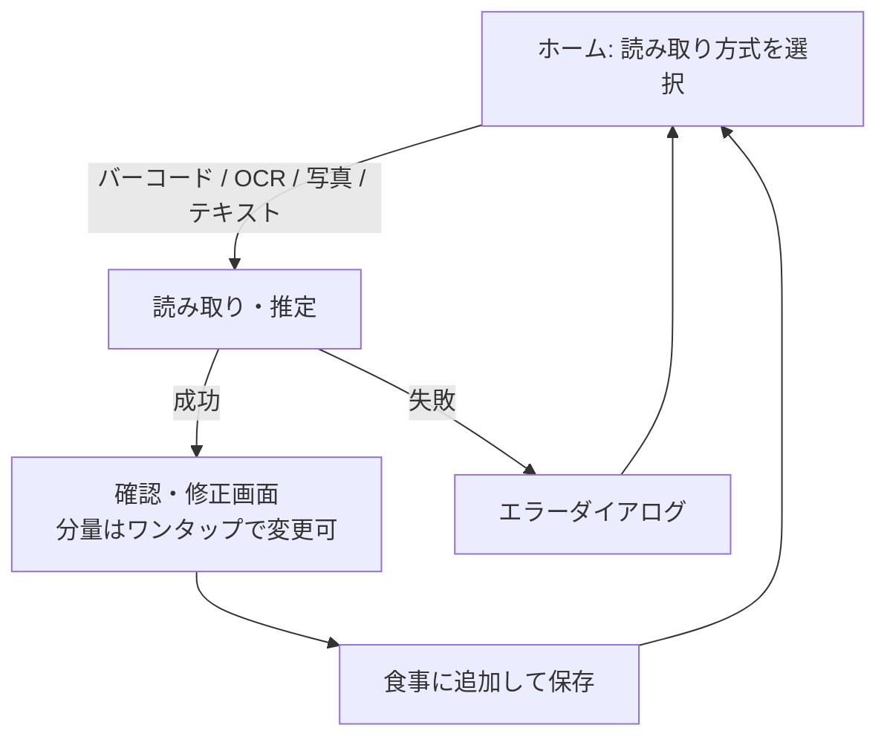

# スコープ（MVP / 次期 / 将来）

> ステータス: Draft（MVP の内容は合意済み。機能仕様 F-xxx への分解は REQ-05 で行う）
> 最終更新: 2026-11-11
> 関連: REQ-04, Q-03, Q-08, Q-09, Q-14〜Q-16, Q-19

## 基本方針

- **人が入力する手間を極力なくす（UX 最優先）**。キーボード入力は最終手段とし、確認・修正はワンタップの選択で済むようにする。
- 記録単位は「食事（Meal）1件に食品（FoodItem）N件」。食品ごとの値と食事合計の両方を持つ。

## MVP

| 区分 | 内容 | 根拠 |
|---|---|---|
| 入力方式 | ①バーコード照合 ②栄養成分表示 OCR ③写真からの AI 推定 ④テキスト入力による推定 | Q-03, Q-19 |
| 分量 | 人は入力しない。既定は「**全部食べた**」とみなす。オプションでワンタップ選択（1/4・1/2・1 など）で直せる | Q-08, Q-14 |
| 読み取れない場合 | **エラーダイアログを表示し、ホームの読み取り方式選択画面に戻る** | Q-15 |
| 1日の境界 | **4:00**（0:00〜3:59 の食事は前日分として集計） | Q-09 |
| 閲覧 | 日次合計＋食事一覧（4時区切り） | Q-16 |
| 確認・修正 | 推定結果の確認・修正画面 | Q-16 |
| 削除 | 食品単位・食事単位の削除 | Q-16 |
| 認証 | Sign in with Apple + Google（最初から入れる） | Q-17, [ADR-0006](../adr/0006-auth-from-day-one.md) |

### 分量の決め方

| 方式 | 取れる値 | 既定の分量 |
|---|---|---|
| バーコード | 商品DBの 100g 当たり／1食当たりの値、内容量 | 1包装を全部。100g 当たりの値は内容量で換算する |
| OCR | 表示の基準量（「1袋（45g）当たり」「100g 当たり」など）と値、内容量 | 1包装を全部。100g 当たりなら内容量（表示から読み取る）で換算する |
| 写真推定 | AI が推定した料理名・量・カロリー・PFC | 写っている量を全部 |
| テキスト入力 | AI が推定した料理名・量・カロリー・PFC | 入力された内容を全部 |
| 共通 | — | 確認画面でワンタップ選択（1/4・1/2・1 など）で直せる |

- 換算に必要な値（内容量など）が読み取れない場合も「読み取れない場合」として扱うかは、PoC の結果（POC-12, POC-23）を見て決める。

### 記録フロー（MVP の概略。詳しくは画面設計 UIX-03）

## MVP 外（次期以降）

- 推移グラフ（週・月）
- 目標値と達成度
- 履歴からの再記録・お気に入り
- 栄養素の拡張（食塩・食物繊維 など）
- その他は roadmap の EXT を参照

## スコープ外（作らない）

- 撮影画像の保存・表示（[ADR-0004](../adr/0004-no-image-retention.md)）
- メールアドレス＋パスワードのログイン（[ADR-0006](../adr/0006-auth-from-day-one.md)）
