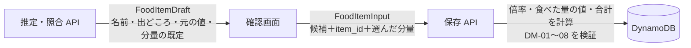

# API 設計（アプリ ⇔ バックエンド）

> ステータス: Draft
> 最終更新: 2026-11-14
> 関連: ARC-04, ARC-08, ARC-09, TST-06, [ADR-0016](../adr/0016-api-rest-openapi.md), [architecture.md](architecture.md), [domain-model.md](domain-model.md), [data-access-patterns.md](data-access-patterns.md)
> 契約（SSOT）: [contracts/api/openapi.yaml](../../contracts/api/openapi.yaml)

## 1. 方針

| 項目 | 決定 |
|---|---|
| スタイル | REST + OpenAPI 3.1（ADR-0016） |
| バージョン | パスの先頭に `/v1`。互換を壊す変更は `/v2` を作り、古いアプリのために `/v1` をしばらく残す |
| 認証 | すべての API で `Authorization: Bearer <Cognito の ID トークン>`。API Gateway が検証し、利用者 ID はトークンの `sub` を使う（アプリから送らせない） |
| 形式 | JSON、名前は snake_case（`contracts/domain`・`contracts/llm` と同じ） |
| スキーマ | 食品の元の値・出どころなどは `contracts/domain/meal.schema.json` を参照し、二重に定義しない。画像の入力は `contracts/llm/*/input.schema.json` を参照する |
| 画像 | base64 で本文に入れる（長辺 1024px の JPEG で約 200KB）。上限 5,000,000 文字（Lambda の 6MB 上限に収める） |

## 2. エンドポイント

| メソッドとパス | 機能 | AP | 説明 |
|---|---|---|---|
| `POST /v1/estimates/label` | F-012 | — | 栄養成分表示の画像を読み、食品の候補（列ごと）を返す。保存はしない |
| `POST /v1/estimates/photo` | F-013 | — | 料理の画像から品目ごとの食品の候補を返す。保存はしない |
| `GET /v1/products/{product_code}` | F-011 | — | バーコードの番号で Open Food Facts を照合し、食品の候補を返す |
| `POST /v1/meals` | F-030 | AP-02 | 食事を作って保存する（食品1件以上） |
| `GET /v1/days/{record_date}` | F-031 | AP-01 | 1日分の食事と日次合計 |
| `GET /v1/days/{record_date}/meals/{meal_id}` | F-020, F-032 | AP-03 | 食事1件 |
| `DELETE /v1/days/{record_date}/meals/{meal_id}` | F-032 | AP-04 | 食事を削除 |
| `POST /v1/days/{record_date}/meals/{meal_id}/items` | F-030 | AP-06 | 既存の食事に食品を足す |
| `DELETE /v1/days/{record_date}/meals/{meal_id}/items/{item_id}` | F-032 | AP-05 | 食事から食品を消す。最後の1件なら食事ごと削除 |

- 食事は「記録日＋食事ID」で指す。バックエンドはその日の食事を範囲検索して食事ID で絞る（1日分は数件なので安い。data-model.md の SK に時刻が入るため）
- アカウント削除（F-002、AP-08）は公開前に足す（`DELETE /v1/me` の予定）

## 3. 推定から保存までの受け渡し

推定・照合 API は、保存用の食品の**候補**（`FoodItemDraft`）を返す。アプリは確認画面で候補を選び、分量を決めて、保存 API に**食品の入力**（`FoodItemInput`）として送る。

| 型 | 中身 |
|---|---|
| `FoodItemDraft` | `name`、`source`、`reference`、`estimate_detail`（domain の定義を参照）、`default_portion`（分量の既定） |
| `FoodItemInput` | `item_id`（UUIDv7、アプリで作る）、`name`（確認画面で直せる）、`source`、`reference`、`estimate_detail`、`portion`（`mode`・`fraction`・`pieces`。倍率は送らない） |

- 倍率・食べた量の値・合計はバックエンドが計算する。アプリから送らせない（ADR-0015）
- `reference` と `source` は候補をそのまま返してもらう。バックエンドはドメインのルール（DM-05・DM-06 など）で検証する（値を書き換えて送られても、出どころと基準の組み合わせが崩れていれば拒否する）

### 3-1. Claude の出力から候補への変換

| 用途 | 変換 |
|---|---|
| OCR（`columns` の各列） | 1列 → 候補1件。`source.column_index` / `column_heading` に列の番号・見出し。`reference.basis` は列の基準をそのまま（`label_text` → `label`）。内容量は量か個数が読めていれば `known`、なければ `unknown` |
| 写真（`items` の各品目） | 1品目 → 候補1件。`reference.basis.type = as_estimated`、`reference.nutrients` は品目の値、`estimate_detail` に量の表現と推定重量、`source.confidence` に品目の信頼度 |
| 共通 | `source.estimation` にモデルID・`prompt_version`・スキーマの `$id` |

### 3-2. 分量の既定（`default_portion`）

| 条件 | 既定 |
|---|---|
| 基準が `per_piece` で内容量の個数が2以上 | `pieces`・1個（Q-27） |
| それ以外 | `whole`（全部、Q-14） |

## 4. 推定 API の結果

| API | `status` | 候補 | アプリの動き |
|---|---|---|---|
| OCR | `ok` | 1件以上（2件以上なら列を選ばせる） | 確認画面 |
| OCR | `unreadable` / `not_nutrition_label` | 0件 | エラーダイアログ（撮り直す・入力方法の選択に戻る、F-021） |
| 写真 | `ok` | 1件以上 | 確認画面（品目ごと） |
| 写真 | `not_food` / `unrecognizable` | 0件 | エラーダイアログ（F-021） |
| バーコード | `found` | 1件 | 確認画面（出どころを表示、OCR へ切り替え可） |
| バーコード | `not_found` | 0件 | エラーダイアログ |

読めない・見つからないは**正常な応答**（HTTP 200）として返す。HTTP のエラーは、入力の不備・認証・外部サービスの障害などに使う。

## 5. エラー（ARC-08）

本文は `{"error": {"code": "...", "message": "..."}}`。`message` は開発者向けで、画面の文言はアプリが `code` から決める。

| HTTP | code | 意味 |
|---|---|---|
| 400 | `validation_error` | 入力がスキーマやドメインのルールに合わない |
| 401 | `unauthorized` | トークンがない・無効（API Gateway が返す） |
| 404 | `not_found` | 食事・食品がない |
| 409 | `meal_already_exists` | 同じ `meal_id` の食事がある（再送。アプリは成功として扱い、取得し直す） |
| 409 | `item_already_exists` | 同じ `item_id` の食品がある（再送） |
| 409 | `version_conflict` | `expected_version` が今の版と違う（ほかの更新と重なった。読み直してやり直す） |
| 413 | `payload_too_large` | 画像が大きすぎる |
| 422 | `estimation_failed` | Claude の応答がスキーマ・ルールに合わない、リフューザル、出力の途切れ |
| 429 | `rate_limited` | 回数の上限（LLM-10） |
| 502 | `upstream_unavailable` | Claude・Open Food Facts に届かない、障害 |
| 500 | `internal_error` | それ以外 |

## 6. 同時更新と再送

- 食事の作成は `meal_id` をアプリで作るので、再送しても二重にならない（409 `meal_already_exists`）
- 食品の追加・削除は `expected_version` を送り、版が違えば 409 `version_conflict`
