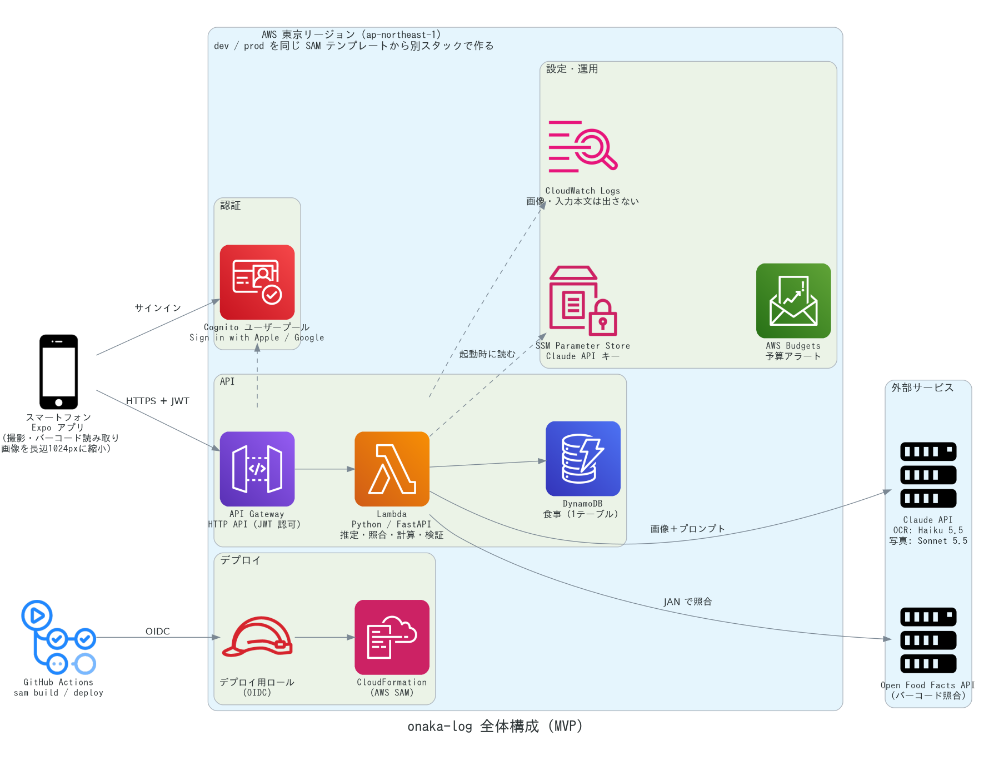
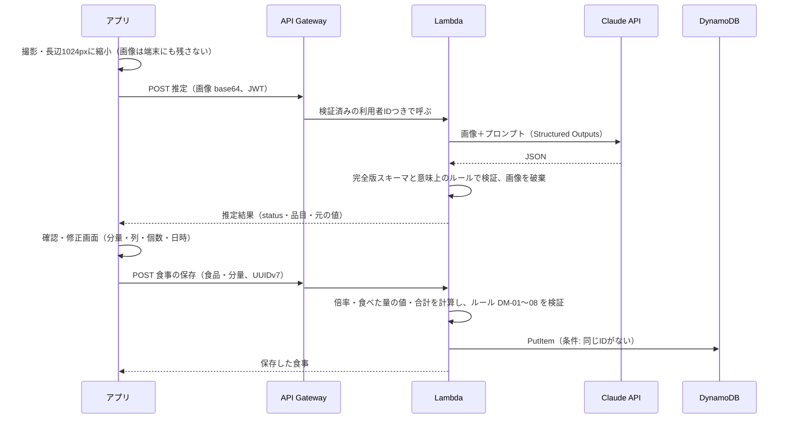

# 全体構成（ARC-01）

> ステータス: Accepted（IaC は [ADR-0014](../adr/0014-iac-aws-sam.md)、データの置き場所・推定の同期・計算の場所は [ADR-0015](../adr/0015-server-first-and-sync-estimation.md)）
> 最終更新: 2026-11-14
> 関連: ARC-01, ARC-02, ARC-07, INF-02〜INF-05, ADR-0003〜0013, [data-model.md](data-model.md), [features](../01_requirements/features/README.md)

## 1. 構成図

- 図は AWS の公式アイコンで描いている。元のコードは [diagrams/architecture.py](diagrams/architecture.py)（Python の `diagrams` ライブラリ）で、描き直し方はファイルの先頭に書いた。構成を変えたらコードを直して描き直す
- 点線は認証・設定・ログなど主な処理の流れではないもの。デプロイ（GitHub Actions → OIDC のロール → CloudFormation）は、AWS 東京リージョンの中のリソース一式を作る
- アプリの中の処理（カメラ・画像の縮小・トークンを Keychain / Keystore に保存）は下の表を参照

| 要素 | 役割 | 決定 |
|---|---|---|
| Expo アプリ | 画面、カメラ・バーコード読み取り、画像の縮小・JPEG 化、トークンの安全な保存 | ADR-0005 |
| Cognito | Apple・Google でのサインイン、JWT の発行 | ADR-0006, ADR-0007 |
| API Gateway（HTTP API） | 入口。JWT を検証してから Lambda に渡す。レート制限 | ADR-0007 |
| Lambda（FastAPI） | API 全体を1つの関数で動かす。推定・照合・換算・検証・保存 | ADR-0007 |
| DynamoDB | 食事の保存（1テーブル） | ADR-0008, ADR-0013 |
| SSM Parameter Store | Claude API キー（SecureString）。アプリには置かない | ADR-0003, INF-04 |
| Claude API | 栄養成分表示の読み取り、写真からの推定 | ADR-0010, ADR-0011 |
| Open Food Facts | バーコード照合。**バックエンドから呼ぶ**（換算規則 ADR-0009 をバックエンドに集め、User-Agent などの利用規約をまとめて守る） | ADR-0009 |

## 2. 主な流れ

### 2-1. 撮影して推定する（OCR・写真）

- 推定は**同期**で返す（ARC-07）。PoC の応答は OCR 約4秒、写真 p90 約5秒で、API Gateway の上限（30秒）に十分収まる
- 推定と保存は別の API にする。推定結果は保存せず、利用者が確認してから保存する（確認画面で直した結果だけが残る）
- 食べた量の値と合計は**バックエンドで計算する**（アプリから送られた計算値は使わない。ドメインのルールを1か所に集める）

### 2-2. バーコード照合

アプリがバーコードを読む → バックエンドが Open Food Facts を呼び、ADR-0009 の順で内容量・基準を決めて返す → 確認画面 → 保存（2-1 と同じ）。

### 2-3. 手入力

確認画面で食品名と値を入力 → 保存（Claude・Open Food Facts は呼ばない）。

## 3. データの置き場所（ARC-02）

**サーバーファースト**（記録の正は DynamoDB。アプリは表示のために一時的に持つだけ）とする（Q-35、ADR-0015）。オフラインでは記録・閲覧できない。

- 推定はどれもオンラインが必要で、オフラインで完結する入力は手入力だけ
- ローカルファースト（端末 DB＋同期）は、同期と競合解決（DAT-09）の実装が大きい
- ID をアプリで作る（ADR-0013）ので、将来オフラインの手入力を足すときも作り直しは少ない

## 4. 環境（INF-02）

| 環境 | 用途 | 中身 |
|---|---|---|
| local | 日常の開発・テスト | FastAPI を `uvicorn` で動かす。DB は DynamoDB Local（Docker）。Claude はテストではモック |
| dev | Lambda 固有の確認（認証・ペイロード上限・IAM）、アプリの結合確認 | AWS 上の一式。Cognito・テーブルは prod と分ける |
| prod | 自分が日常で使う | AWS 上の一式 |

- 環境ごとにスタック・テーブル・Cognito ユーザープールを分ける（`onaka-log-dev` / `onaka-log-prod`）
- IaC は AWS SAM で、dev と prod を同じテンプレートから作る（INF-03、Q-34、ADR-0014）

## 5. セキュリティとログ

- 利用者 ID は JWT から取り、アプリから送られた値は使わない。DynamoDB は `PK = USER#` でしか読まない（AUT-05）
- 画像はメモリ上で扱い、ディスク・ログ・DB に残さない（ADR-0004）。ログに出すのは、方式・モデル・トークン数・応答時間・status・エラー種別まで
- Claude API キーは SSM Parameter Store の SecureString に置き、Lambda の実行ロールにだけ読む権限を与える
- 予算アラート（AWS Budgets）を最初に作る（INF-10）

## 6. 費用の見込み（自分専用、月）

| 項目 | 見込み |
|---|---|
| Claude API | 写真推定 月90回で約170円（ADR-0011）＋ OCR 数円 |
| Lambda・API Gateway・DynamoDB・Cognito | 自分専用の量ならほぼ0円（無料枠・従量課金の最小単位） |
| SSM Parameter Store（標準） | 0円 |
| CloudWatch Logs | 数円程度（保持期間を短くする） |
| 合計 | 約200円前後（月1000円 NFR-001 に収まる） |

## 7. 決定（2026-11-14）

| ID | 決定 |
|---|---|
| Q-34 | IaC は AWS SAM（比較: [iac-comparison.md](discussions/iac-comparison.md)、[ADR-0014](../adr/0014-iac-aws-sam.md)） |
| Q-35 | サーバーファースト。オフラインの記録・閲覧は MVP では作らない（[ADR-0015](../adr/0015-server-first-and-sync-estimation.md)） |
