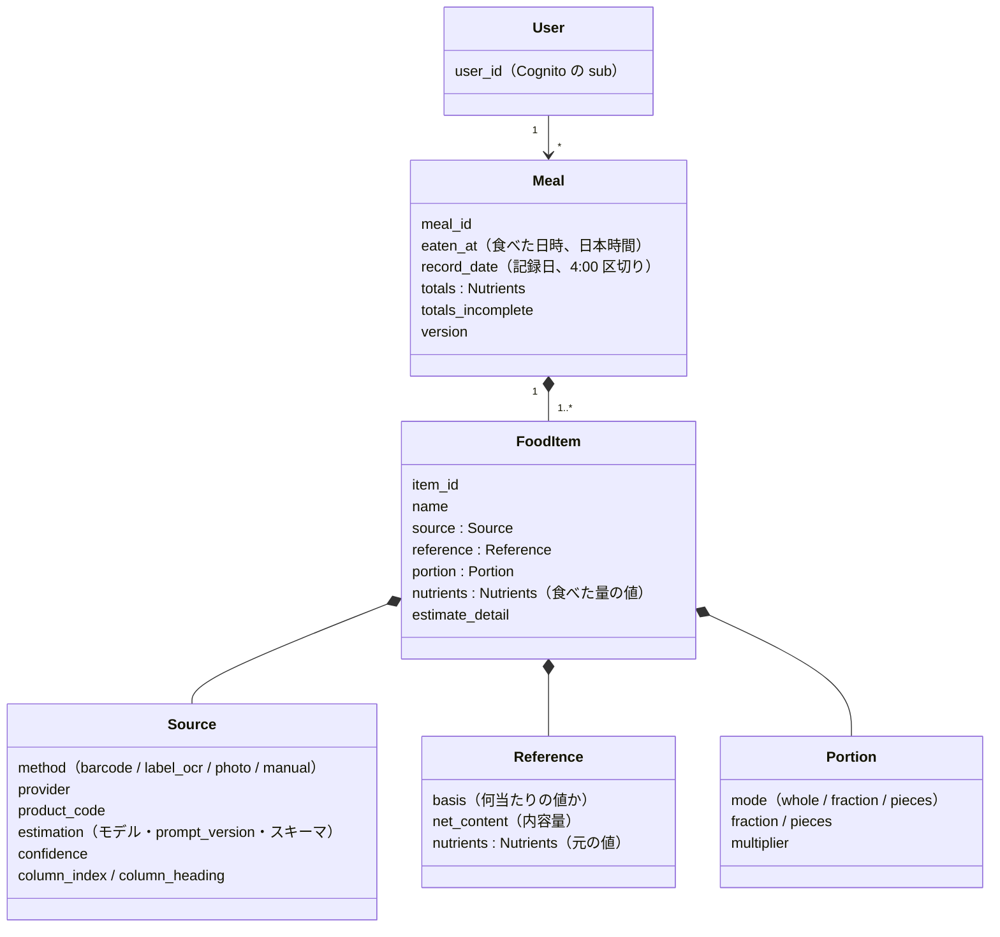

# ドメインモデル（DAT-01）

> ステータス: Draft
> 最終更新: 2026-11-14
> 関連: DAT-01〜DAT-08, [data-model.md](data-model.md), [data-access-patterns.md](data-access-patterns.md), [機能一覧](../01_requirements/features/README.md), ADR-0008, ADR-0009, ADR-0013
> 契約（SSOT）: [contracts/domain/meal.schema.json](../../contracts/domain/meal.schema.json)

## 1. 全体像



- **Meal（食事）**: 1回の記録でできるまとまり。後から食品を足せる（Q-32）。食事区分は持たない
- **FoodItem（食品）**: 食事の中の1品。Meal の中に埋め込む（ADR-0008）。保存後は値を直さない（Q-31）
- **Nutrients（栄養値）**: kcal・P・F・C の値オブジェクト。各値は「不明」を表すために null を許す
- 画像は持たない（ADR-0004）。商品マスタ（DAT-10）は MVP では持たず、バーコード照合の結果は食品の中にそのまま残す

## 2. 値の決まり方: 元の値 × 倍率 = 食べた量の値

食品は、取得・推定した**元の値**（reference）と、分量の選択（portion）から計算した**食べた量の値**（nutrients）の両方を持つ（DAT-04）。日次合計・食事の合計は食べた量の値から作る。

```
nutrients = reference.nutrients × portion.multiplier（小数第1位で四捨五入）
```

### 2-1. 元の値の基準（reference.basis.type）

| type | 意味 | 使う方式 |
|---|---|---|
| `per_100g` / `per_100ml` | 100g（ml）当たり | バーコード、OCR |
| `per_package` | 1包装当たり | OCR |
| `per_serving` | 1食当たり | OCR |
| `per_piece` | 1個当たり（量の記載がないことが多い） | OCR |
| `as_estimated` | 写真に写っている量の推定値 | 写真推定 |
| `as_entered` | 利用者が入力した値（食べた量の値そのもの） | 手入力 |

### 2-2. 内容量（reference.net_content）

| status | 意味 | 例 |
|---|---|---|
| `known` | 内容量が分かっている | Open Food Facts の内容量、栄養成分表示の「内容量 110g」 |
| `assumed_from_serving` | 内容量は不明だが、1食分の量を全量とみなした | Open Food Facts に1食分の量だけある（ADR-0009 の優先2、「1食当たり（推定）」） |
| `unknown` | 分からない | 確認画面に「内容量：不明」を出す（ADR-0009） |

写真推定と手入力は内容量を持たない（`net_content` は null）。

### 2-3. 分量（portion）と倍率（multiplier）

「全部」の倍率（whole の倍率）を基準の種類で決め、分量の選択を掛ける。

| 基準 | 「全部」の倍率 |
|---|---|
| `per_100g` / `per_100ml`、内容量が `known` か `assumed_from_serving`（単位が一致） | 内容量 ÷ 100 |
| `per_100g` / `per_100ml`、内容量が `unknown`（または単位が合わない） | 1（100g 食べたとみなす。ADR-0009 の優先3） |
| `per_package` / `per_serving` / `as_estimated` / `as_entered` | 1 |
| `per_piece`、内容量の個数が分かっている | 個数（例: 4個入りなら 4） |
| `per_piece`、個数が分からない | 1 |

| mode | 倍率 | 使いどころ |
|---|---|---|
| `whole` | 「全部」の倍率 | 既定（Q-14） |
| `fraction` | 「全部」の倍率 × fraction（例: 0.5） | ワンタップの 1/4・1/2 など |
| `pieces` | pieces（例: 1個なら 1） | 基準が `per_piece` のときだけ。複数個入りの既定は 1個（Q-27） |

- 手入力（`as_entered`）は `whole` だけ（換算しない、ADR-0012）
- 例: Open Food Facts の 100g 当たり 450kcal、内容量 76g、全部 → 倍率 0.76 → 342kcal

## 3. 出どころ（source）

| method | provider | 必須の情報 |
|---|---|---|
| `barcode` | `open_food_facts` | `product_code`（JAN） |
| `label_ocr` | `claude` | `estimation`（モデルID・prompt_version・スキーマの ID）。複数列から選んだときは `column_index` と `column_heading` |
| `photo` | `claude` | `estimation`、`confidence`。量の表現と推定重量は `estimate_detail` |
| `manual` | `user` | なし |

推定に使ったモデル・プロンプト・スキーマのバージョンを食品ごとに残す（LLM-07、DAT-05）。Claude の生の出力全体は保存しない（必要な値は reference と estimate_detail に移す。画像も保存しない）。

## 4. 合計

- 食事の合計（totals）は、食品の食べた量の値を足して、**書き込み時に計算して保存**する（DAT-02、ADR-0008）。小数第1位で四捨五入
- null（不明）の値は 0 として足し、どの栄養素に不明が含まれるかを `totals_incomplete` に残す（例: OCR で脂質が読めなかった食品がある → `["fat_g"]`）。画面で「一部不明」を出せるようにする
- 日次合計は、その日の食事の totals をコードで足す（AP-01）

## 5. 日時

- `eaten_at`: 食べた日時。日本時間（`+09:00`）の ISO 8601、秒まで（Q-33）
- `record_date`: 記録日。`eaten_at` から 4時間引いた日付（1日の境界 4:00、Q-09）
- `created_at` / `updated_at`: 作成・更新の日時（UTC）
- 保存後に `eaten_at` は変えない（Q-33）。食品を足す・消すと `updated_at` と `version` が変わる

## 6. ルール（不変条件）

JSON Schema で表せない次のルールは、バックエンドで検証する。契約テスト（`tests/contract/domain_rules.py`）に同じルールがあり、例ファイルがそれを満たすことを確かめている。

| ID | ルール |
|---|---|
| DM-01 | `record_date` は、`eaten_at`（日本時間）から 4時間引いた日付 |
| DM-02 | `totals` の各値は、食品の `nutrients` の和（null は 0）を小数第1位で四捨五入した値。`totals_incomplete` は、null を含む栄養素の一覧（重複なし、`energy_kcal`・`protein_g`・`fat_g`・`carbohydrate_g` の順） |
| DM-03 | 食品の `nutrients` の各値は、`reference.nutrients × portion.multiplier` を小数第1位で四捨五入した値。元の値が null なら null |
| DM-04 | `portion.multiplier` は §2-3 の規則どおり |
| DM-05 | `source.method` ごとの組み合わせ（§3）と、基準の種類: barcode は `per_100g` / `per_100ml`、label_ocr は `per_*`、photo は `as_estimated`、manual は `as_entered` |
| DM-06 | `portion.mode = pieces` は基準が `per_piece` のときだけ。manual は `whole` だけ |
| DM-07 | 食事の中で `item_id` は重複しない |
| DM-08 | 食事には食品が1件以上ある（0件になったら食事ごと削除する、Q-31） |
