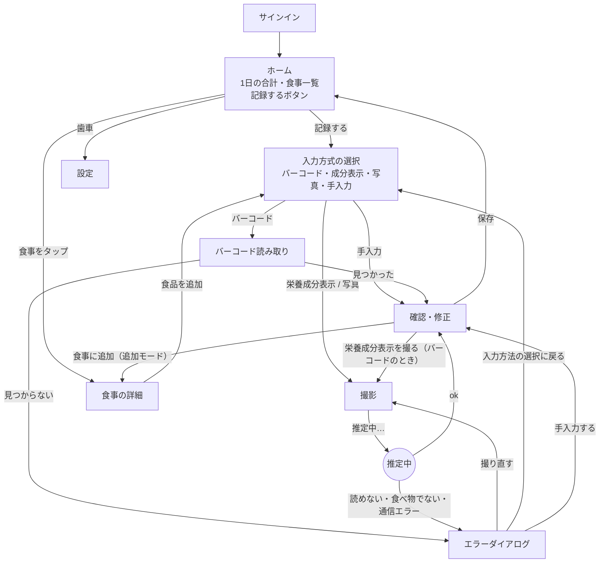

# 画面設計（MVP）

> ステータス: Draft（主な論点は Q-36〜Q-39 で決定済み）
> 最終更新: 2026-11-14
> 関連: UIX-01〜UIX-05, UIX-07〜UIX-10, UIX-12, [機能一覧](../../01_requirements/features/README.md), [scope.md](../../01_requirements/scope.md), [api.md](../api.md)

基本方針（scope.md）: **人が入力する手間を極力なくす**。確認・修正はワンタップの選択で済ませ、キーボード入力は手入力（最後の手段）と料理名の修正だけにする。

## 1. 画面一覧

| 画面 | 英名（コード上の名前） | 機能 | 主な API |
|---|---|---|---|
| サインイン | `sign-in` | F-001 | Cognito |
| ホーム（1日の記録） | `home` | F-031 | `GET /v1/days/{date}` |
| 入力方式の選択（シート） | `method-select` | F-010 | — |
| バーコード読み取り | `barcode-scan` | F-011 | `GET /v1/products/{code}` |
| 撮影（栄養成分表示・料理） | `camera` | F-012, F-013 | `POST /v1/estimates/label` / `photo` |
| 確認・修正 | `confirm` | F-020, F-014 | `POST /v1/meals`、`POST …/items` |
| 食事の詳細 | `meal-detail` | F-020, F-032, F-030 | `GET`・`DELETE …/meals/{id}`、`DELETE …/items/{id}` |
| 設定 | `settings` | F-001（F-002 は公開前） | — |
| 共通: 推定中・エラーダイアログ・削除の取り消し・カメラの許可 | — | F-021, F-032 | — |

手入力（F-014）は専用の画面を作らず、確認・修正画面の「入力モード」で行う。

## 2. 画面遷移



- ホームは1日の記録と「記録する」ボタン。押すと入力方式の選択（シート）が開く（Q-36）
- エラーダイアログの「入力方法の選択に戻る」は、この入力方式の選択に戻る（Q-15）。最後の手段として「手入力する」も置く（ADR-0012）

## 3. 画面ごとの仕様

### 3-1. ホーム（`home`）

```
┌──────────────────────────────┐
│ ◀  11月13日（木）  ▶     ⚙  │  日付の移動（前日・翌日）。今日より先には進めない
├──────────────────────────────┤
│  1,842 kcal                   │  日次合計（kcal は整数）
│  P 72.4g  F 61.0g  C 228.5g   │  一部不明があれば「一部不明」の印
├──────────────────────────────┤
│ 08:00  職場のお菓子      150  │  食事一覧（時刻順）。1行 = 1食事
│ 12:30  カップ麺（しょうゆ味）351 │  名前は食品名を「、」でつなぐ（長ければ省略）
│ 19:15  ご飯、ハンバーグ、… 702 │  タップで食事の詳細
│                               │  記録がない日は「まだ記録がありません」
├──────────────────────────────┤
│        [ ＋ 記録する ]         │  画面の下に固定（片手で押せる）
└──────────────────────────────┘
```

- 起動時は今日（4:00 区切りの記録日）を開く
- 記録日の移動は前日・翌日のボタンだけ（カレンダーは MVP 外。UIX-06）
- 過去の日を表示しているときに「記録する」を押すと、確認画面の食べた日時の既定はその日の今の時刻にする（日時は確認画面で変えられる、Q-33）

### 3-2. 入力方式の選択（`method-select`）

画面の下から出るシート。4つのボタン（バーコード・栄養成分表示・写真・手入力）と閉じるボタン。食事の詳細の「食品を追加」からも同じシートを開く（そのときは追加モード）。

### 3-3. バーコード読み取り（`barcode-scan`）

- カメラの映像の中でバーコードを自動で読む（シャッター不要）。読めたら照合 API を呼び、推定中の表示
- 見つかれば確認・修正画面、見つからなければエラーダイアログ

### 3-4. 撮影（`camera`）

- 栄養成分表示と料理で同じ画面。上部に「栄養成分表示を撮る」「料理を撮る」と案内を出す
- 栄養成分表示のときは撮り方の案内（正面から・近づけて・表示全体が入るように）を常に小さく出す
- 撮影後、アプリ内で長辺 1024px に縮小し、推定 API に送る。画像は端末にも保存しない（ADR-0004）

### 3-5. 確認・修正（`confirm`）— 最も重要な画面（UIX-04）

推定・照合の結果（候補）を表示し、分量などを決めて保存する。

```
┌──────────────────────────────┐
│ ×  確認                       │
├──────────────────────────────┤
│ 食べた日時  11/13 12:30  ✎    │  既定は記録した時刻。タップで日時を変更（過去も可、Q-33）
├──────────────────────────────┤
│ ┌ 食品カード ───────────────┐ │
│ │ ドーナツ（シュガー）    ✎  │ │  食品名（タップで修正）。列を変えると名前も列に合わせる
│ │ 栄養成分表示 ・ 1個当たり   │ │  出どころ・基準。内容量不明なら「内容量：不明」
│ │ 味: [●シュガー] [ チョコ ] │ │  複数列のときだけ。先頭の列を選んだ状態で開く（Q-37）
│ │ 分量: [●1個][2個][3個][全部]│ │  個数売りは個数、それ以外は [全部][3/4][1/2][1/4]
│ │ 250 kcal  P1.5 F22.7 C10.0 │ │  選んだ分量での値（プレビュー）
│ └─────────────────────────┘ │
│ （写真推定は品目ごとにカード。不要な品目は × で外せる） │
├──────────────────────────────┤
│ 合計  250 kcal                │
│ [栄養成分表示を撮る]          │  バーコードのときだけ（登録ミス対策、ADR-0009）
│ [        保存する        ]    │  追加モードでは「食事に追加」
└──────────────────────────────┘
```

| 要素 | 仕様 | 根拠 |
|---|---|---|
| 出どころ | 「Open Food Facts」「栄養成分表示」「写真（目安）」「手入力」 | ADR-0009, Q-28 |
| 基準・内容量 | 「1包装当たり・内容量 78g」「1食当たり（推定）・内容量：不明」「100g当たり・内容量：不明」など | ADR-0009 |
| 列の選択 | 候補が2件以上のときだけ、見出し（なければ「1列目」「2列目」）のボタンを並べる。**先頭の列を選んだ状態**で開き、そのまま保存できる。違う列で記録しないよう、列のボタンはカードの上の方に目立つように置く | Q-26, Q-37 |
| 分量 | 既定は候補の `default_portion`（全部、個数売りは1個）。ワンタップで変更 | Q-14, Q-27 |
| 値のプレビュー | アプリでドメインの計算を行って表示する。保存される値はバックエンドの計算（同じ規則） | ADR-0015 |
| 一部不明 | 読めなかった栄養素は「—」と表示し、合計に「一部不明」 | DM-02 |
| 写真の目安 | 画面上部に「写真からの推定（目安）です」。信頼度が低い品目に「目安」の印 | Q-28 |
| 品目を外す | 写真推定の品目は × で外せる（0件になったら保存できない） | F-020 |
| 名前の修正 | タップでキーボード入力 | F-020 |
| 保存後の修正 | できない（保存前にここで直す） | Q-31 |

**入力モード（手入力、F-014）**: 食品カードの代わりに、食品名・kcal・P・F・C の入力欄を出す。**5項目すべて必須**で、すべて入れるまで保存できない（Q-38、DM-09）。数値は小数第1位まで。分量の選択はない（ADR-0012）。

### 3-6. 食事の詳細（`meal-detail`）

- 食べた日時、食品ごとの値（出どころ・基準・分量・内容量不明の表示を含む）、食事の合計
- 「食品を追加」: 入力方式の選択（追加モード）→ 各画面 → 確認・修正（追加モード）→ この画面に戻る（Q-32）
- 値の修正はできない（Q-31）
- 削除は 3-9 のとおり、確認なしで消して「元に戻す」を出す

### 3-7. 設定（`settings`）

- サインアウト、アプリの版。アカウントと記録の削除（F-002）は公開前に足す

### 3-8. サインイン（`sign-in`）

- 「Apple でサインイン」「Google でサインイン」の2つだけ（ADR-0006）

### 3-9. 削除と「元に戻す」（F-032、Q-39）

- 食品・食事を削除する操作をすると、**確認ダイアログを出さず**、すぐ画面から消して、画面の下に「削除しました［元に戻す］」を約5秒出す
- **アプリは表示が消えている間、削除 API をすぐには呼ばない**。5秒たつか、画面を離れる・アプリを閉じる（バックグラウンドに移る）と削除 API を呼ぶ。「元に戻す」を押したら呼ばずに表示を戻す
  - DynamoDB は物理削除なので（ADR-0013）、サーバー側で消した後に戻すのではなく、アプリ側で送るのを遅らせる。API の変更は要らない
  - 送る前にアプリが強制終了されたときは削除されない（次に開くと残っている）。安全側の失敗として許容する
- 最後の食品を消すと食事ごと消え（Q-31）、ホームに戻って同じく「元に戻す」を出す
- 同じ食事への削除が続いたときは、版の番号（`expected_version`）を順に更新して送る。409 `version_conflict` なら読み直す

## 4. 共通のパターン（UIX-09）

| 場面 | 表示 |
|---|---|
| 推定中 | 画面全体に「読み取り中…」（写真は「推定中…」）と進行の表示。キャンセルできる。目安 4〜5秒（PoC） |
| 通信中（一覧・保存） | ボタンの中のくるくる。二度押しを防ぐ |
| 空の日 | 「まだ記録がありません」と、「記録する」ボタンへの案内 |
| カメラの許可がない | 理由（撮影して栄養を読み取るため）と、設定アプリを開くボタン。手入力へも進める |
| オフライン | 「インターネットに接続できません」。記録・閲覧はできない（ADR-0015） |
| 削除 | 3-9 のとおり「元に戻す」を約5秒 |

### 4-1. エラーダイアログの文言（F-021、api.md §5 の code から決める）

| 場面（status / code） | タイトル | 本文 | ボタン |
|---|---|---|---|
| OCR `unreadable` | 読み取れませんでした | 栄養成分表示を正面から、近づけて撮り直してください | 撮り直す / 手入力する / 入力方法の選択に戻る |
| OCR `not_nutrition_label` | 栄養成分表示が見つかりません | 栄養成分表示の部分を撮ってください | 撮り直す / 入力方法の選択に戻る |
| 写真 `not_food` | 食べ物が見つかりません | 料理全体が入るように撮ってください | 撮り直す / 入力方法の選択に戻る |
| 写真 `unrecognizable` | 料理を判別できませんでした | 明るい場所で、料理全体が入るように撮り直してください | 撮り直す / 手入力する / 入力方法の選択に戻る |
| バーコード `not_found` | 商品が見つかりません | 栄養成分表示を撮ると記録できます | 栄養成分表示を撮る / 手入力する / 入力方法の選択に戻る |
| `estimation_failed` / `upstream_unavailable` / `internal_error` | うまくいきませんでした | 時間をおいてもう一度お試しください | もう一度 / 入力方法の選択に戻る |
| `rate_limited` | 少し時間をおいてください | 短時間に多く使われたため、一時的に止めています | 閉じる |
| `payload_too_large` | 画像が大きすぎます | もう一度撮影してください | 撮り直す |
| `version_conflict` | 内容が更新されています | 最新の内容を読み込みました。もう一度操作してください | 閉じる（読み込み直す） |
| `meal_already_exists` / `item_already_exists` | （表示しない） | 再送なので成功として扱い、取得し直す | — |
| `unauthorized` | （サインイン画面へ） | トークンを更新し、だめならサインインし直す | — |

## 5. 手数の目標（UIX-12）

| 操作 | タップ数 |
|---|---|
| 写真で記録（分量そのまま） | 4（「記録する」→「写真」→ シャッター → 保存） |
| バーコードで記録 | 3（「記録する」→「バーコード」→ 自動で読む → 保存） |
| 栄養成分表示で記録（先頭の列のまま） | 4（「記録する」→「成分表示」→ シャッター → 保存） |
| 分量・列を変える | それぞれ ＋1 |

## 6. ワイヤーフレームの作り方（UIX-10）

MVP はこの文書のテキストの図で十分とする。見た目を詰める段階で、HTML のモック（必要ならブラウザで開ける1枚の HTML）を作る。デザインシステム（色・文字・ダークモード、UIX-11）は実装の前に別に決める。
