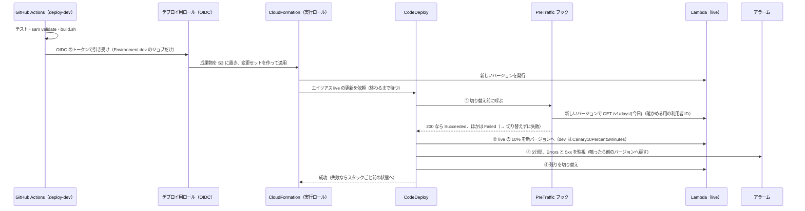

# CI/CD

> ステータス: Draft（検査のワークフローと dev へのデプロイ。アプリのビルドは実装に合わせて足す）
> 最終更新: 2026-11-17
> 関連: CIC-01〜CIC-10, [strategy.md](../03_testing/strategy.md) §6, ADR-0014, ADR-0017, ADR-0019

## 1. 今あるワークフロー

| ファイル | 名前 | いつ動く | やること |
|---|---|---|---|
| [.github/workflows/contract.yml](../../.github/workflows/contract.yml) | `contract` | `main` への push と pull request（下のパスが変わったとき）、手動 | ① `uv sync --locked`（dev・poc グループ） ② `pytest tests/contract poc`（実 API は呼ばない） ③ `tools/trace.py --check`（仕様とテストの対応） |
| [.github/workflows/api.yml](../../.github/workflows/api.yml) | `api` | `main` への push と pull request（`apps/api/`・`contracts/`・依存の変更）、手動 | ① `uv sync --locked` ② Ruff（lint・整形）③ mypy（domain は strict）④ `pytest apps/api/tests`（DynamoDB Local をサービスコンテナで動かし、保存先のテストを skip させない） |
| [.github/workflows/mobile.yml](../../.github/workflows/mobile.yml) | `mobile` | `main` への push と pull request（`apps/mobile/`・`contracts/api/`・`contracts/domain/` の変更）、手動 | ① `npm ci` ② `npm run gen:api` で作り直した API の型に差分がないこと（契約とのずれを防ぐ、CIC-03） ③ `tsc --noEmit` ④ ESLint＋Prettier ⑤ Jest |
| [.github/workflows/infra.yml](../../.github/workflows/infra.yml) | `infra` | `main` への push と pull request（`infra/`・`apps/api/`・`contracts/`・依存の変更）、手動 | ① `sam validate --lint` ② cfn-lint（`template.yaml`・`github-deploy.yaml`） ③ `infra/build.sh`（Lambda に載せるコードが uv.lock どおりに作れるか）。SAM CLI・cfn-lint は版を固定して `uvx` で動かす。AWS の認証情報は使わず、デプロイはしない |
| [.github/workflows/deploy-dev.yml](../../.github/workflows/deploy-dev.yml) | `deploy-dev` | `main` への push（バックエンド・`infra/template.yaml`・`samconfig.toml`・依存の変更）、手動。リポジトリ変数 `AWS_DEPLOY_ROLE_ARN_DEV` が空なら動かない | ① テスト（DynamoDB Local 込み）と `sam validate` ② `infra/build.sh` ③ OIDC でデプロイ用ロールを引き受け ④ `sam deploy --config-env dev --no-confirm-changeset --role-arn <実行ロール>`。Lambda は CodeDeploy で切り替える（§5） |

`contract` の対象のパス: `contracts/`・`tests/`・`tools/`・`apps/api/`（trace.py がバックエンドのテストの ID も集めるため）・`poc/`・`docs/01_requirements/`・`docs/02_design/`・`docs/03_testing/`（trace.py が仕様の ID を読むため）・`pyproject.toml`・`uv.lock`・`.python-version`・ワークフロー自身。

## 2. 決めたこと

- **GitHub Actions** を使う（CIC-01）
- **Action はコミットの SHA で固定する**（タグの付け替えによる改ざんを防ぐ）。版はコメントに書く。更新は Dependabot で行う予定（CIC-08）
- **権限は最小**（`contents: read`）。チェックアウトの認証情報は残さない（`persist-credentials: false`）
- **依存は `uv.lock` どおり**（`--locked`。ロックと pyproject.toml がずれていたら失敗する）
- 同じブランチで新しい実行が始まったら古い実行を止める（`concurrency`）
- シークレットは使わない（実 API のテストは CI の既定で動かさない。strategy.md §3-2）。AWS へは OIDC の一時的な認証情報だけで入る（ADR-0019）。ロールの ARN は秘密ではないのでリポジトリ変数に置く
- デプロイは途中で止めない（`cancel-in-progress: false`）。CloudFormation の更新を中断させないため

## 3. 今後足すもの

| 時期 | ワークフロー | 中身 |
|---|---|---|
| prod を作るとき | `deploy-prod` | タグか手動で prod にデプロイ。GitHub の Environment `prod` に承認者を付ける（ADR-0019） |
| 学習として | CodePipeline 版 | 同じデプロイを CodePipeline＋CodeBuild で作って比べる（ADR-0019 の選択肢 B） |
| 必要になったら | `live`（手動） | 実 API のスモーク（`-m live`）。キーは GitHub の Environment のシークレットに置き、費用の上限を決める（CIC-04） |
| 早めに | Dependabot | GitHub Actions・uv・npm の依存更新（CIC-08） |

## 4. ローカルで同じことをする

```bash
wsl -e bash -lc "cd /mnt/c/project/onaka-log && UV_LINK_MODE=copy ~/.local/bin/uv run --group dev --group poc pytest tests/contract poc -q"
wsl -e bash -lc "cd /mnt/c/project/onaka-log && UV_LINK_MODE=copy ~/.local/bin/uv run --group dev python tools/trace.py --check"
```

- `uv run --group dev` は `apps/api` の中から実行すると失敗する（dev グループはルートの pyproject.toml にある）。CI もローカルもルートから `apps/api` を指して動かす

インフラの検査（SAM CLI・cfn-lint は WSL のホームに入れてある。[infra/README.md](../../infra/README.md)）:

```bash
wsl -e bash -lc "cd /mnt/c/project/onaka-log/infra && SAM_CLI_TELEMETRY=0 ~/.local/bin/sam validate --lint --region ap-northeast-1 && ~/.local/bin/cfn-lint template.yaml"
```

ワークフローの書き方の検査（actionlint を Docker で。Docker がなければ `~/.local/bin/uvx --from actionlint-py actionlint`）:

```bash
wsl -e bash -lc 'cd /mnt/c/project/onaka-log && docker run --rm -v "$PWD:/repo:ro" -w /repo rhysd/actionlint:latest .github/workflows/*.yml'
```

## 5. dev へのデプロイの仕組み（ADR-0019）



- 切り替え方は `infra/samconfig.toml` の `DeploymentType`（`AllAtOnce`・`Canary10Percent5Minutes` など）。手元から `sam deploy` しても同じ仕組みで切り替わる
- 自分専用で要求が少ないので、Canary の間にアラームが鳴ることはまれ。主な確認は PreTraffic フック
- 経過は CodeDeploy のコンソール（アプリ `onaka-log-dev-ServerlessDeploymentApplication-…`）と、フックのログ（`/aws/lambda/CodeDeployHook_onaka-log-pretraffic-dev`）で見る
- **ロールバックを試す**: わざと壊したコード（例: 起動時に例外）を dev に出すと、フックが Failed になり、`live` は前のバージョンのまま、スタックは更新前に戻る
- 準備（AWS 側の IAM・GitHub の変数・Environment）は [infra/README.md](../../infra/README.md) の「CI からのデプロイの準備」
