# ADR-0007: バックエンドは AWS サーバーレス（API Gateway + Lambda + FastAPI + Cognito）

- ステータス: Accepted（DB は DynamoDB に決定: [ADR-0008](0008-database-dynamodb.md)）
- 日付: 2026-11-11
- 関連: Q-12, Q-21, ARC-03, TEC-05, TEC-06, INF-01, AUT-03, [比較資料](../../議論/バックエンド構成/バックエンド構成比較.md)

## 背景

Claude API をバックエンド経由で呼ぶ必要がある（ADR-0003）。運用コストは月1000円まで（NFR-001）。認証は最初から Apple + Google（ADR-0006）。Python の経験がある。比較資料で4案（A: Supabase、B: AWS コンテナ、C: AWS サーバーレス、D: ハイブリッド）を比べた。

## 決定

**C案: AWS サーバーレス構成**を採用する。

```mermaid
flowchart LR
    App[Expo アプリ] -->|Apple / Google ログイン| Cognito[Cognito]
    App -->|JWT 付きリクエスト| APIGW[API Gateway<br>HTTP API]
    APIGW -->|JWT 検証| Cognito
    APIGW --> Lambda[Lambda<br>Python / FastAPI]
    Lambda --> DB[(DynamoDB)]
    Lambda --> Claude[Claude API]
    Lambda --> Product[商品DB API]
```

| 要素 | 採用 |
|---|---|
| 認証 | Amazon Cognito（Sign in with Apple / Google） |
| API の入口 | API Gateway（HTTP API）。JWT の検証は API Gateway の認可機能で行う |
| アプリケーション | AWS Lambda 上の Python（FastAPI）。Lambda Web Adapter などで、同じコードをローカルの `uvicorn` でも動かす |
| DB | DynamoDB（[ADR-0008](0008-database-dynamodb.md)） |
| リージョン | 東京（ap-northeast-1）を基本とする |

## 理由

- 使った分だけの課金で、自分専用なら月ほぼ0円。月1000円に収まる（B案のコンテナ常時起動は月4,500円以上の見込み）
- Python（FastAPI）の経験が活きる。FastAPI は OpenAPI と相性がよく、契約駆動（ADR-0001）に合う
- 公開して利用者が増えても、従量課金で費用が滑らかに増える
- AWS の実務的な経験が積める

## 影響・注意点

- **AWS アカウントのプラン**: 新規アカウントの Free プランは6か月後またはクレジットを使い切った時点で閉じられる。継続して使うには Paid プランに切り替える必要がある。**予算アラート（AWS Budgets）を最初に設定する**（INF-06）
- **ペイロード上限**: Lambda の同期呼び出しはリクエスト・レスポンスとも 6MB まで。画像はアプリ側で縮小・圧縮してから送る（POC-42）
- **ローカル再現**: 日常の開発・テストは `uvicorn` + pytest で行い、Lambda 固有の部分（認証・ペイロード上限・タイムアウト・IAM）は開発用の AWS 環境で確認する（比較資料 C-4）
- **コールドスタート**: 初回応答が遅れることがある。推定の待ち時間と合わせて、PoC 後に許容範囲を決める
- **IaC が必要**: 構成要素が多いため、手作業ではなく IaC（AWS SAM / CDK / Terraform など）で管理する（INF-03）
- アプリの Cognito 連携（Expo からの Apple / Google ログイン）は実装時に検証が必要（AUT-03）
- 移行しやすさのため、推定ロジック（プロンプト・スキーマ検証・換算）は Lambda に依存しない純粋なモジュールとして書く

## 見直す条件

- 構築・運用の手間が MVP の進行を大きく妨げた場合（A案 Supabase への切り替えを検討）
- 月額が予算を継続的に超えた場合
