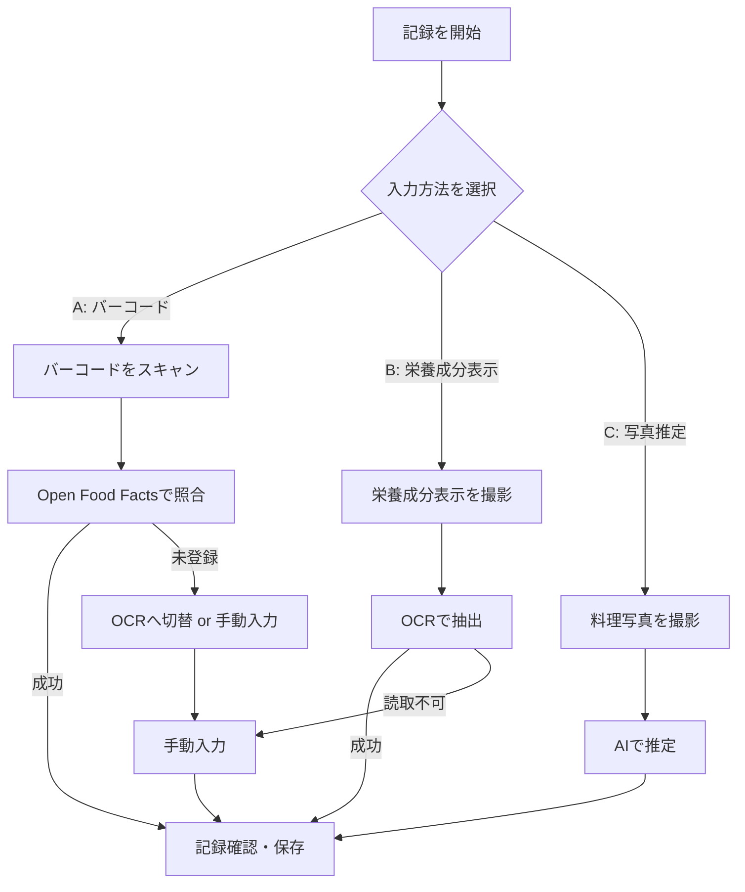
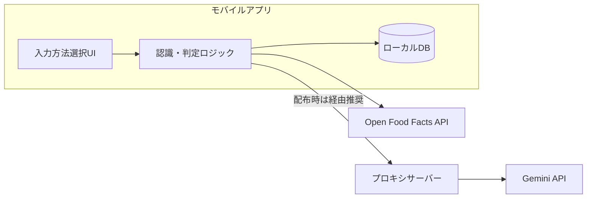

# 食事記録アプリ フロー・アーキテクチャ(改訂版)

## 1. 処理フロー(入力方法・選択式)

### 1-1. 全体像
自動フォールバックではなく、記録開始時にユーザーが入力方法を選択する方式に変更する。各方式で情報取得に失敗した場合は手動入力、または他方式への切り替えを促す。

1. 記録を開始
2. 入力方法を選択(以下いずれか)
   - A. バーコード照合
   - B. 栄養成分表示OCR
   - C. 写真AI推定
3. 選択した方式の処理を実行(下記1-2)
4. 記録確認・保存(共通、1-3)

### 1-2. 方式ごとの処理

**A. バーコード照合**

| ステップ | 内容 |
|---|---|
| 1 | バーコードをスキャン(端末上でデコード、ML Kit/ZXing等) |
| 2 | Open Food Facts APIで商品照合 |
| 3a(成功) | 商品名・カロリー・PFCを取得 → 記録確認へ |
| 3b(失敗) | DB未登録 → 「OCRに切り替える」または「手動入力」を提示 |

**B. 栄養成分表示OCR**

| ステップ | 内容 |
|---|---|
| 1 | パッケージの栄養成分表示部分を撮影 |
| 2 | VLM/OCRでテキスト抽出 → カロリー・PFCを構造化 |
| 3a(成功) | 記録確認へ |
| 3b(失敗) | 読み取り不可 → 手動入力 |

**C. 写真AI推定(自炊・外食)**

| ステップ | 内容 |
|---|---|
| 1 | 料理の写真を撮影 |
| 2 | VLM(Gemini等)で料理名・推定量・カロリー/PFCを推定 |
| 3 | 推定結果を記録確認へ(常にユーザー修正前提) |

### 1-3. 共通: 記録確認・保存
- いずれかの方式で得られた値、または手動入力値をユーザーが確認・修正
- ローカルDBに保存する

---

## 2. システム構成

### 2-1. 全体構成

| レイヤー | 内容 |
|---|---|
| クライアント(モバイルアプリ) | 入力方法選択UI、カメラ/バーコードスキャナー、認識・判定ロジック、ローカルDB |
| 外部API | Open Food Facts(商品DB照合)、Gemini API(OCR・写真AI推定) |
| プロキシサーバー(任意) | Gemini APIキーを保護する薄い中継層。アプリを配布するなら実質必須 |

### 2-2. クライアント内部の構成要素
- **入力方法選択UI**: バーコード/OCR/写真の3ボタンから選択
- **認識・判定ロジック**: 選択された方式の処理を実行し、成功/失敗を判定してフォールバック先を提示
- **ローカルDB**: `meals`(食事記録)、`product_cache`(商品キャッシュ)を保持

### 2-3. データモデル(ローカルDB)
- `meals`: id, datetime, food_name, calorie, protein, fat, carb, source(barcode/ocr/photo/manual), image_path
- `product_cache`: barcode, product_name, calorie, protein, fat, carb, fetched_at

### 2-4. セキュリティ上の注意
- Gemini APIキーをクライアントに直接埋め込むと、アプリ解析によりキーを抜かれるリスクがある
- 個人利用のみ(配布しない)なら直接埋め込みも許容範囲
- 配布予定がある場合はCloudflare Workers等の無料枠でプロキシを挟み、キーはサーバー側のみに置く

---

## 3. 技術選定の目安
- クロスプラットフォーム: Flutter / React Native
- ローカルDB: SQLite(Flutter: sqflite/drift、RN: WatermelonDB等)
- バーコードスキャン: ML Kit Barcode Scanning / ZXing(いずれも無料・オンデバイス)
