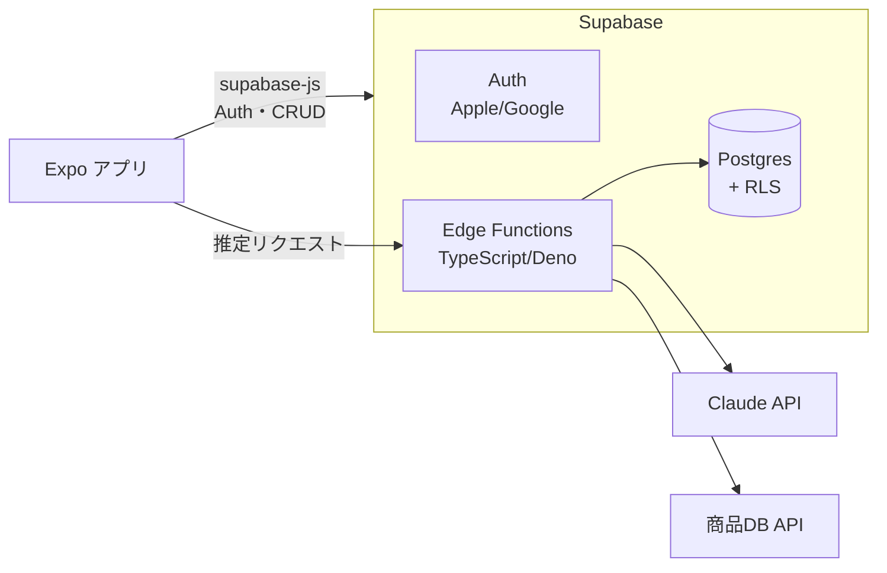
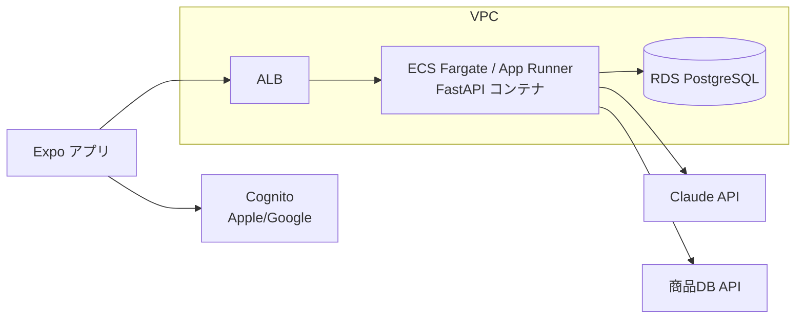
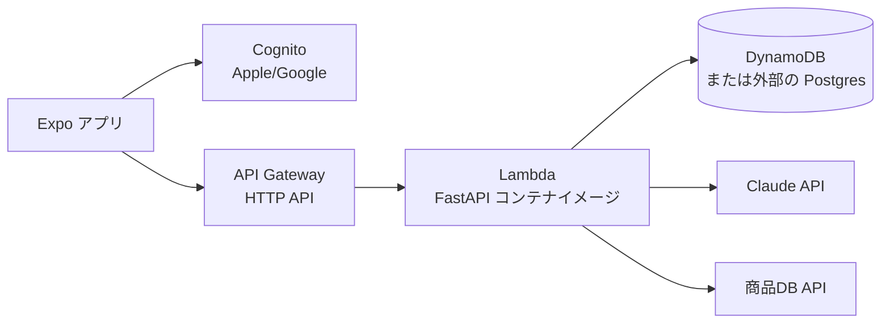
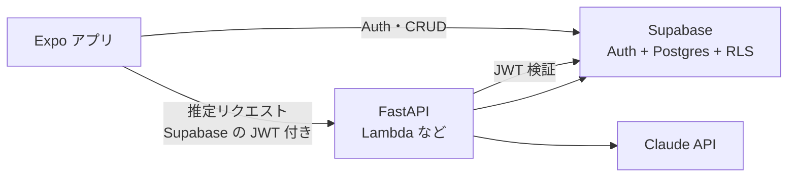

# バックエンド構成の比較（Q-12 判断材料）

> ステータス: 議論用資料。**結論: C案（AWS サーバーレス）に決定 → [ADR-0007](../../docs/adr/0007-backend-aws-serverless.md)**。DB の選択は Q-21
> 作成: 2026-11-11
> 関連: [open-questions.md](../../docs/00_project/open-questions.md) Q-12、roadmap ARC-03 / TEC-05 / TEC-06 / INF-01 / AUT-03

---

## 1. 前提条件（決定済み事項から）

| 前提 | 内容 | 出典 |
|---|---|---|
| アプリ | React Native（Expo）+ TypeScript | Q-11 |
| 利用者 | 直近は自分専用、将来はストア公開 | ADR-0003 |
| Claude API | **バックエンド経由で呼ぶ**（キーをアプリに持たせない） | ADR-0003 |
| 認証 | 最初から入れる。Sign in with Apple + Google | Q-17 |
| 画像 | 保存しない。推定が済んだらすぐ破棄 | ADR-0004 |
| コスト | **月1000円程度まで**（ストア登録費は別枠） | NFR-001, Q-13 |
| 開発環境 | WSL から開発。リポジトリは C ドライブ上 | Q-18 |
| 経験 | React・Python あり。AWS・Supabase は未確認 | Q-05 |

## 2. バックエンドが担う責務

どの構成でも、次の責務を満たす必要がある。

1. **認証**: Apple / Google ログイン、トークン発行・検証、アカウント削除
2. **データの保存と取得**: 食事（Meal）・食品（FoodItem）の作成・取得・更新・削除と、日次集計（4時区切り）。他人のデータを見られないようにする（認可）
3. **推定 API**: 画像またはテキストを受け取り、Claude API を呼び、出力をスキーマで検証して返す（OCR・写真推定・テキスト推定）
4. **バーコード照合**: 外部の商品DBを呼び、結果をキャッシュする
5. **コスト制御**: ユーザーごとの回数制限、画像サイズの上限
6. **秘密情報の管理**: Claude API キーなど

このうち 2（CRUD）は定型的、3（推定）はこのアプリ固有のロジック、という性格の違いがある。

---

## 3. 候補構成

### A. Supabase に全部寄せる

- CRUD はアプリから supabase-js で直接 DB を操作する。認可は Postgres の **行レベルセキュリティ（RLS）** で「自分の行だけ」を強制する
- 推定・バーコード照合だけ Edge Functions（TypeScript）に書く
- アプリと同じ TypeScript で統一できる

### B. AWS 上にコンテナ（FastAPI）＋ RDS（ユーザー提案の構成）

- FastAPI がすべての API を提供する（CRUD も推定も）
- Python の経験が活き、OpenAPI も FastAPI から出せる
- 一般的な Web バックエンドの構成。AWS の実務的な経験が積める

### C. AWS サーバーレス（FastAPI を Lambda で動かす）— B のコストを抑えた代替案

- B と同じ FastAPI のコードを Lambda で動かす（Lambda Web Adapter や Mangum を使う）。使った分だけ課金なので、常時起動のコストがない
- DB は DynamoDB（従量課金）にするか、外部の無料枠 Postgres を使う。RDS を置くと結局常時課金になる

### D. ハイブリッド: Supabase（認証・DB）＋ Python（推定 API）

- 定型的な部分（認証・CRUD）は Supabase に任せ、アプリ固有の推定ロジックだけ Python で書く
- 管理する場所が2つになるので、構成はやや複雑になる

---

## 4. 比較表

評価: ◎ とても良い / ○ 良い / △ 注意 / × 不向き

| 観点 | A. Supabase | B. AWS コンテナ | C. AWS サーバーレス | D. ハイブリッド |
|---|---|---|---|---|
| **月額コスト**（自分専用） | ◎ 0円（無料枠） | × 約4,000〜7,000円（§5） | ◎ ほぼ0円 | ◎ ほぼ0円 |
| **月1000円に収まるか** | ◎ | × | ◎ | ◎ |
| 公開後に利用者が増えたとき | △ 無料枠を超えると Pro（$25/月〜）へ段階的に上がる | ○ 構成はそのまま増強できる | ◎ 従量で滑らかに増える | △ A と同じ |
| 初期構築の速さ | ◎ 認証・DB・API が最初から揃う | × VPC・ALB・RDS・Cognito・IaC と構築が多い | △ Cognito・API Gateway・IAM の設定が必要 | ○ |
| 運用の手間 | ◎ ほぼ不要 | × パッチ・スケール設定・監視が必要 | ○ | ○ |
| 言語 | TypeScript（アプリと統一） | Python | Python | TS（アプリ側）＋ Python（推定） |
| 既存経験の活用 | ○ React/TS の延長 | ◎ Python | ◎ Python | ◎ |
| 認証（Apple + Google） | ◎ 設定だけで使える | ○ Cognito で可能。設定はやや煩雑 | ○ 同左 | ◎ |
| 認可（自分のデータだけ） | ○ RLS で DB 側に強制。**RLS の書き忘れが事故につながる**のでテスト必須 | ○ アプリコードで実装 | ○ 同左 | ○ RLS |
| 契約駆動（OpenAPI）との相性 | △ CRUD は DB スキーマが契約になる。OpenAPI を書くのは推定 API だけ | ◎ OpenAPI → FastAPI で素直 | ◎ 同左 | ○ |
| ローカル開発（WSL） | ◎ Supabase CLI で一式（Docker）をローカル起動できる | ○ docker compose | △ Lambda のローカル再現にひと手間 | △ 2系統を起動 |
| テスト | ○ Deno test・pgTAP（RLS のテスト） | ◎ pytest | ◎ pytest | ○ |
| ベンダーロックイン | △ Supabase 固有 API。ただし DB は普通の Postgres | ○ コンテナなので移しやすい | △ AWS 固有部分あり | △ |
| 学習価値 | BaaS の使い方 | ◎ AWS の実務構成 | ○ AWS サーバーレス | 両方 |
| 主な制約 | 無料プロジェクトは**1週間使わないと一時停止**、Edge Functions は CPU 2秒／リクエスト（待ち時間は含まない） | 常時課金 | 同期呼び出しのデータは **6MB まで**（画像は圧縮が必要）、コールドスタート | 2系統の整合性 |

---

## 5. コストの目安

> Claude API の費用（自分専用で月 約20〜400円、[non-functional.md](../../docs/01_requirements/non-functional.md)）は全構成で共通なので除いている。1 USD ≒ 150円。

### A. Supabase（Free プラン）

| 項目 | 無料枠 | このアプリでの見込み（自分専用） |
|---|---|---|
| DB 容量 | 500 MB | 食事記録は1件数KB。数年分でも余裕あり |
| 認証ユーザー | 月 50,000 MAU | 1人 |
| Edge Functions 実行回数 | 月 500,000 回 | 月数百回 |
| データ転送（egress） | 5 GB | 画像は保存しないので小さい |
| 無料プロジェクト数 | 有効なものは2つまで | 開発用と本番用で2つ使える（開発はローカルでも可） |
| **合計** | — | **0円** |

- **注意: 無料プロジェクトは「1週間使わないと一時停止」される**。毎日使うなら問題ないが、使わない期間があると再開操作が必要。有料プラン（Pro、$25/月〜 ≒ 3,750円）にすると停止しないが、予算を超える
- 公開して利用者が増えた場合は、無料枠の超過または停止の回避のために Pro が必要になる可能性が高い
- **一時停止からは自動では復帰しない**。ダッシュボードで手動で再開（Restore project）する必要があり、アプリからアクセスしただけでは戻らない。停止中の保持期間には限りがあり、長く放置すると復元できなくなる可能性があるため、長期間使わないならバックアップを取る（※挙動は要確認。決定前に公式ドキュメントで確認すること）
- 旅行などで1週間以上使わないとアプリが接続できなくなり、PC での再開操作が要る。対策（定期的に軽いリクエストを送る等）は必要なら open-questions に積む

### B. AWS コンテナ（常時起動）

| 項目 | 単価（公式） | 月額の目安 |
|---|---|---|
| Fargate 0.25 vCPU / 0.5 GB × 24時間 | vCPU 約 $0.0405/時、メモリ 約 $0.00445/GB時（バージニア北部） | 約 $9（東京はこれより高い） |
| パブリック IPv4 アドレス | $0.005/時（1個あたり） | 約 $3.7/個 |
| ALB（ロードバランサー） | ※未確認の目安 | 約 $18〜 |
| RDS PostgreSQL（最小構成） | ※未確認の目安 | 約 $15〜20＋ストレージ |
| NAT Gateway（プライベートサブネットから外部 API を呼ぶ場合） | ※未確認の目安 | 約 $30〜（避ける設計が必要） |
| **合計** | — | **約 $30〜50 ≒ 4,500〜7,500円**（NAT Gateway なしでも予算超過） |

- App Runner や Lightsail コンテナにすると ALB 代は省けるが、それでも常時起動の分で予算を超えやすい
- **AWS の新規アカウント特典はクレジット方式**: すぐに $100、条件を満たすとさらに最大 $100、計最大 $200 を6か月間。Free プランのアカウントは、6か月後またはクレジットを使い切った時点で閉じられる（継続するには Paid プランへの切り替えが必要）。長期の無料運用には使えない

### C. AWS サーバーレス

| 項目 | 月額の目安（自分専用） |
|---|---|
| Lambda | 月数百回の実行なら無料枠内（無料枠の具体的な数値は要確認） |
| API Gateway HTTP API | ほぼ0円 |
| Cognito（Lite / Essentials） | 月 10,000 MAU まで無料（12か月の期限なし） |
| DynamoDB | 少量ならほぼ0円 |
| **合計** | **ほぼ0円** |

- Lambda の**同期呼び出しはリクエスト・レスポンスとも 6MB まで**。画像は base64 にすると約1.33倍になるので、アプリ側で約4MB 未満に圧縮する（いずれにしても精度・速度・トークン数の面から縮小するのが前提: POC-42）
- タイムアウトの上限は15分（Lambda 側）。Claude の応答待ちには十分

---

## 6. 構成ごとの注意点

### A. Supabase
- **RLS がセキュリティの要**。テーブルを作るたびにポリシーを書き、「他人のデータが読めない」ことをテスト（pgTAP など）で保証する
- Edge Functions は Deno 実行環境。Anthropic の TypeScript SDK は npm 指定で使える想定（PoC で確認）
- CPU 時間の上限2秒は「Claude の応答を待つ時間」を含まないので、推定 API には問題ない見込み。壁時計の上限は150秒（Free）
- 日次集計（4時区切り）は Postgres のビューや関数で書ける

### B. AWS コンテナ
- 外部 API（Claude）を呼ぶ必要があるため、プライベートサブネットに置くと NAT Gateway の費用が大きい。パブリックサブネットに置く設計なら避けられるが、セキュリティ設計の手間が増える
- IaC（Terraform / CDK）を書かないと再現性が下がる。学習価値は高いが MVP の速度は落ちる

### C. AWS サーバーレス
- FastAPI を Lambda に載せる構成は実績があるが、コールドスタート（初回応答の遅延）がある
- DynamoDB は SQL ではないため、日次集計などは設計を工夫する必要がある。SQL を使いたいなら外部の Postgres（Supabase の DB だけ使う＝D に近づく）

#### C-1. DynamoDB に保存する形式（案）

- **Meal の中に FoodItem を配列で埋め込む**（推奨案）。1アイテム＝1食事で、`items: [{name, kcal, p, f, c}, ...]` を持つ。食事合計は書き込み時に計算して Meal の属性として保存する（「食品ごとと食事合計の両方の値を持つ」に対応）
- キーは パーティションキー `userId`、ソートキー `日付(4:00補正後)#時刻`（例: `2026-11-11#12:00`）。1日分を範囲検索でき、4:00 境界の扱いも簡単になる
- 1食あたりの食品数は少なく、アイテム上限（400KB）には十分余裕がある
- 代案: 単一テーブルで Meal と FoodItem を別アイテムにする（`SK=MEAL#...` / `SK=MEAL#...#ITEM#1`）。食品単位の検索・更新には向くが設計が複雑になる

#### C-2. DynamoDB での集計

DynamoDB には `GROUP BY` / `SUM` に当たる機能がない。「キーで範囲を絞って取得し、合計はコードで計算する」か「書き込み時に集計値を作っておく」方式になる。

| 集計 | 方法 |
|---|---|
| 日次 | その日の範囲を検索し、Lambda 側で合計（1日数件なので軽い） |
| 食事ごと | Meal に食事合計を保存済み。読み取るだけ |
| 週・月の推移 | 30日分（最大150件程度）を取得して日ごとに合計。足りなければ日次サマリ用アイテム（`SK=SUMMARY#2026-11-11` に kcal・P・F・C）を持つ。食事の追加・修正・削除と同じ `TransactWriteItems` で更新し、ずれを防ぐ |

- 苦手なこと: 食品名での横断検索（GSI の追加か全件スキャンが必要）、後から増えた集計軸（曜日別平均など。キー設計の見直しが必要になることがある）
- 自分専用・少件数なら集計は問題なく実現できる。栄養の推移グラフ・食品別ランキング・期間比較などを今後増やす予定があるなら、Postgres のほうが楽（SQL を書き足すだけ）

#### C-3. DB を Postgres（Supabase）にする場合

構成: アプリ → Cognito（認証）→ API Gateway → Lambda（FastAPI）→ Supabase Postgres。アプリは Supabase を直接触らず、Lambda 経由でだけ DB を使う。D とは「認証が Cognito のまま」「RLS に頼らずアプリコードで `user_id` を絞る」点が違う。

- 無料プロジェクトなので**一時停止リスクが残る**（停止中は Lambda から DB に繋がらず、手動で再開するまでアプリが動かない）
- Lambda は同時実行ごとに接続を張るため、接続プーラー（Supavisor のトランザクションモード）経由で繋ぐ
- Lambda と Supabase のリージョンを揃える（東京同士など）。揃えないと遅い
- AWS と Supabase の2系統でシークレット・監視を管理する
- 他の候補: AWS 内の Aurora Serverless v2 等は常時課金で月1000円に厳しい見込み（要確認）。Neon など他の無料 Postgres は停止条件が異なる可能性があり、無料枠のスリープ仕様とあわせて要比較

#### C-4. ローカルでの再現がひと手間な理由

Lambda は「イベントを受けて関数が1回動く」仕組みで、通常の Web サーバーと違う。

- **入口が違う**: 本番は API Gateway が HTTP をイベント JSON に変換して渡す。ローカルの `uvicorn` 起動は Lambda 経由の動作とは別物
- **周辺サービスがない**: Cognito・API Gateway（6MB 制限等）・IAM はローカルにない。JWT 検証、権限不足、ペイロード上限などは本番側でしか出ない
- **実行環境の差**: Lambda 専用の OS・ランタイム・メモリ/タイムアウト制限。Linux 向けバイナリ依存の食い違いが起きうる
- **コールドスタート**はローカルで再現しにくい

| 方法 | 再現度 | 手間 |
|---|---|---|
| FastAPI を `uvicorn` で起動（Lambda Web Adapter なら同じコードが Lambda でも動く） | 低 | 小 |
| AWS SAM CLI（`sam local start-api`、Docker で Lambda と API Gateway を模倣） | 中 | 中 |
| LocalStack（AWS 全体を模倣。Cognito など一部は有料版） | 中〜高 | 大 |
| 開発用の AWS スタックにデプロイして確認 | 高 | 反映が遅い |

- 現実的な進め方: 日常の開発・テストは `uvicorn` + pytest。Lambda 固有部分（認証・6MB・タイムアウト・IAM）は開発用 AWS 環境で確認する
- 比較表で A が「Supabase CLI で一式をローカル起動できる」と◎、C が△なのは、認証から DB まで丸ごとローカルで再現する手段が C にはないため（SAM / LocalStack の仕様は要確認）

### D. ハイブリッド
- Supabase が発行した JWT を Python 側で検証する実装が必要
- 2つの場所にデプロイ・監視・シークレットが分散する

---

## 7. 判断の観点（自問リスト）

1. **AWS を使うこと自体が目的（学習・ポートフォリオ）か？**
   - Yes → C（または D）。B は予算超過なので、やるなら期間限定と割り切る
   - No → A
2. **バックエンドを Python で書きたいか？**
   - Yes → C か D
   - こだわらない → A（アプリと同じ TypeScript で統一でき、型も共有しやすい）
3. **MVP をどれだけ早く動かしたいか？**
   - 早く → A
4. **公開後の利用者規模の見込みは？**
   - 少数のまま → A でも長く無料
   - 大きく伸ばしたい → C の従量課金が滑らか。A は Pro（$25/月〜）に移る時点がある

---

## 8. 推奨（たたき台）

**MVP は A（Supabase に全部寄せる）を推奨する。**

- 月1000円以内に確実に収まり、認証（Apple + Google）・DB・API が最初から揃うので、MVP の本質（推定精度と UX）に集中できる
- アプリと同じ TypeScript で、契約（JSON Schema）から型を1回生成すれば両方で使える
- **B（AWS コンテナ）は月4,500円以上かかる見込みで、予算と合わない**。AWS を使いたい場合は C を推奨する

**移行しやすくするための設計上の工夫**（どの構成を選んでもやる）

- 推定ロジック（プロンプト・スキーマ検証・栄養値の換算）は、実行環境に依存しない純粋なモジュールとして書き、Edge Functions／Lambda はその薄い入口にする
- Claude API の入出力は `contracts/llm/` の JSON Schema を正とする（ADR-0001）
- DB は Postgres の標準的な機能を中心に使い、Supabase 固有の機能への依存は認証と RLS に限定する

## 9. 決まったら更新するもの

- ADR（バックエンド構成）を新規作成し、open-questions の Q-12 を解決済みへ移す
- roadmap: ARC-03, TEC-05, TEC-06, INF-01, AUT-03
- `docs/02_design/architecture.md`, `infra.md`, `auth.md` の初版

---

## 出典（2026-11-11 に確認）

- Supabase 料金: https://supabase.com/pricing
- Supabase Edge Functions の制限: https://supabase.com/docs/guides/functions/limits
- AWS 無料利用枠: https://aws.amazon.com/free/
- Lambda のクォータ: https://docs.aws.amazon.com/lambda/latest/dg/gettingstarted-limits.html
- Cognito 料金: https://aws.amazon.com/cognito/pricing/
- Fargate 料金: https://aws.amazon.com/fargate/pricing/（東京リージョンの単価は取得できず、バージニア北部の値を使用）
- VPC 料金（パブリック IPv4）: https://aws.amazon.com/vpc/pricing/
- 「※未確認の目安」と書いた ALB・RDS・NAT Gateway の金額は公式ページで未確認。決定前に AWS 料金計算ツール（https://calculator.aws/ ）で東京リージョンの値を確認すること
